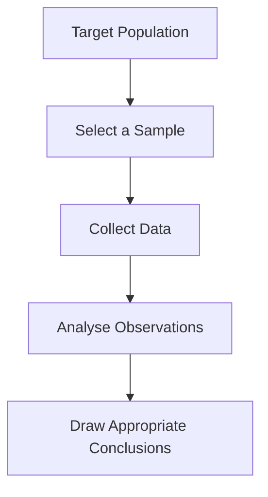

# Statistics Fundamentals

## Chapter Overview

Statistics is the foundation of Data Science, Data Analysis, and Machine Learning. Before analysing a dataset or building a predictive model, we need to understand what the data represents, how it was collected, whether it represents the population of interest, and what limitations may affect the conclusions.

For example, before predicting customer behaviour, a Data Scientist should understand which customers are represented in the dataset, how customer information was collected, whether important observations are missing, and whether the data contains systematic bias.

This chapter introduces the fundamental concepts required to understand and work with real-world datasets. Detailed descriptive-statistics calculations, probability theory, and statistical inference are covered in their respective chapters.

### Learning Objectives

After completing this chapter, you should be able to:

- Explain the role of statistics in Data Science and Machine Learning.
- Distinguish between populations, samples, parameters, and statistics.
- Identify different types of data and variables.
- Understand the four levels of measurement.
- Distinguish structured, semi-structured, and unstructured data.
- Understand data collection methods and sampling techniques.
- Recognise sampling bias, sampling error, and non-sampling errors.
- Differentiate observational studies from experiments.
- Evaluate basic data quality before performing statistical analysis.

---

## 1. Introduction to Statistics

Statistics is the science of collecting, organising, summarising, analysing, interpreting, and communicating data.

Raw data does not always provide a clear understanding of a problem. Statistical methods help us identify patterns, understand variation, evaluate evidence, and make informed decisions.

In Data Science, statistics helps answer questions such as:

- What does a dataset represent?
- Is the dataset suitable for the problem being investigated?
- Is the sample representative of the target population?
- Which statistical methods are appropriate for the available variables?
- Could errors or bias affect the results?
- How reliable are the conclusions drawn from the data?

Statistics is commonly divided into two major branches.

### 1.1 Descriptive Statistics

Descriptive statistics summarises and describes the observations available in a dataset.

It includes measures such as mean, median, mode, variance, standard deviation, frequency distributions, and graphical summaries.

For example, a company may summarise the average order value and distribution of customer purchases.

Detailed explanations, formulas, worked examples, and Python implementations are covered in `02_Descriptive_Statistics`.

### 1.2 Inferential Statistics

Inferential statistics uses sample data to estimate population characteristics or evaluate claims about a population.

For example, a university with 20,000 students may survey 500 selected students to estimate the average daily study time of all its students.

Because the estimate is based on a sample, uncertainty must be considered.

Sampling distributions, estimation, and confidence intervals are covered in `05_Inferential_Statistics`. Statistical tests are covered in `06_Hypothesis_Testing`.

**Key distinction:** Descriptive statistics describes the available observations, while inferential statistics uses data to draw conclusions about a broader population.

---

## 2. Data, Observations, and Variables

### 2.1 What Is Data?

Data is a collection of recorded facts, measurements, values, or observations gathered for a particular purpose.

Consider the following student dataset.

| Student | Age | Study Hours | Department |
|---|---:|---:|---|
| A | 20 | 3.5 | CSE |
| B | 21 | 5.0 | CSE |
| C | 20 | 2.0 | ECE |
| D | 22 | 4.5 | CSE |

This dataset contains information about students, including their ages, study hours, and departments.

### 2.2 Observation

An **observation** is one recorded instance in a dataset.

In a typical tabular dataset:

- Each row represents an observation.
- Each column represents a variable or feature.

For example, a dataset containing information about 1,000 customers will generally have 1,000 observations if each customer is represented by one row.

The structure can be different for time-series data, transaction records, images, and other data formats, so the meaning of an observation depends on the dataset.

### 2.3 Variable

A **variable** is a characteristic that can take different values across observations.

Examples include:

- Age
- Salary
- Product category
- Study hours
- Customer status
- Number of purchases

In Machine Learning, variables used as model inputs are commonly called **features**. The variable a model is trained to predict is called the **target** or **label**.

For example, a customer churn model might use account age, monthly spending, and support requests as features to predict whether a customer will leave.

---

## 3. Population and Sample

The distinction between a population and a sample is fundamental to statistical analysis.

### 3.1 Population

A **population** is the complete group of individuals, objects, events, or measurements relevant to a statistical investigation.

Examples include:

- All students enrolled at a university.
- All customers of a company.
- All transactions recorded by a bank during a specified period.
- All houses in a city.
- All products manufactured during a particular month.

A population does not necessarily consist of people. It is the complete group about which we want to learn.

### 3.2 Sample

A **sample** is a subset of the population selected for analysis.

Suppose a university has 20,000 students and collects information from 500 selected students.

- Population: 20,000 students.
- Sample: 500 selected students.

The relationship can be expressed as:

$$
\text{Sample} \subseteq \text{Population}
$$

The process can be represented as:



### 3.3 Why Do We Use Samples?

Studying an entire population may be expensive, time-consuming, or impractical.

Sampling allows researchers and Data Scientists to analyse a manageable portion of the population.

However, a large sample is not automatically representative. If the sampling method systematically excludes important groups, the resulting conclusions may still be misleading.

### 3.4 Census

A **census** attempts to collect information from every member of the population being studied.

A sample survey collects information from only a selected subset.

| Census | Sample Survey |
|---|---|
| Attempts to cover the entire population | Studies a subset of the population |
| Often requires more resources | Often requires fewer resources |
| Can avoid sampling error when coverage is complete | Has sampling variability |
| Can still contain measurement and recording errors | Can contain sampling and non-sampling errors |

A census does not automatically guarantee perfect data quality. Missing records, inaccurate measurements, and data-processing mistakes can still occur.

---

## 4. Parameter and Statistic

A **parameter** is a numerical value describing a population.

A **statistic** is a numerical value calculated from a sample.

Suppose we want to know the average height of all students at a university.

- The average height of all university students is a population parameter.
- The average height of selected students is a sample statistic.

Common statistical notation includes:

| Quantity | Population Notation | Sample Notation |
|---|---|---|
| Mean | $\mu$ | $\bar{x}$ |
| Standard deviation | $\sigma$ | $s$ |
| Variance | $\sigma^2$ | $s^2$ |
| Size | $N$ | $n$ |
| Proportion | $P$ or $\pi$ | $\hat{p}$ |

Here, \(N\) represents population size, while \(n\) represents sample size.

The notation helps distinguish quantities describing an entire population from quantities calculated using a sample.

Sample statistics are often used to estimate unknown population parameters. Because different samples can produce different statistics, the estimate may not equal the true population parameter.

Detailed descriptive-statistics formulas are covered in `02_Descriptive_Statistics`.

---

## 5. Types of Data

Understanding the type of data is essential because different statistical methods are appropriate for different variables.

Data can first be classified as qualitative or quantitative.

### 5.1 Qualitative Data

**Qualitative data** represents categories, labels, or qualities rather than numerical measurements.

Examples include:

- Department
- Blood group
- Product category
- Payment method
- Browser type
- Customer status

For example:

| Customer | Payment Method |
|---|---|
| A | UPI |
| B | Card |
| C | Cash |
| D | UPI |

These values represent categories.

Categories may be encoded numerically, such as `1 = Cash`, `2 = UPI`, and `3 = Card`. However, these codes are labels and do not automatically represent measurable quantities.

### 5.2 Quantitative Data

**Quantitative data** represents numerical quantities that can be counted or measured.

Examples include:

- Age
- Height
- Weight
- Salary
- Number of purchases
- Website loading time

Quantitative data is commonly divided into discrete and continuous data.

---

## 6. Discrete and Continuous Data

### 6.1 Discrete Data

**Discrete data** consists of distinct, countable values.

Examples include:

- Number of students in a classroom.
- Number of products sold.
- Number of defects in a batch.
- Number of calls received by a support centre.

A count might take values such as:

$$
0,1,2,3,4,\ldots
$$

A count of complete products sold is normally a whole number rather than a fraction of a product.

### 6.2 Continuous Data

**Continuous data** represents measurements that can take values throughout a range, subject to the precision of the measurement process.

Examples include:

- Height
- Weight
- Temperature
- Time duration
- Distance

For example, a measured height might be recorded as 170 cm, 170.2 cm, or 170.25 cm.

The number of decimal places recorded depends on the measuring instrument and the required precision.

### 6.3 Comparison

| Property | Discrete Data | Continuous Data |
|---|---|---|
| Nature | Countable values | Measured values |
| Examples | Number of purchases, errors | Height, weight, time |
| Typical values | Separate count values | Values throughout a range |
| Common source | Counting | Measurement |

Some variables require careful classification. Age, for example, can be recorded as completed years, making the recorded values discrete, even though elapsed time since birth is continuous.

---

## 7. Levels of Measurement

The **level of measurement** describes the mathematical properties of a variable and helps determine which comparisons and operations are meaningful.

The four commonly used levels are nominal, ordinal, interval, and ratio.

<image src="https://media.geeksforgeeks.org/wp-content/uploads/20251206123755209876/the_four_level_of_measu.webp" alt="Four levels of measurement" />

### 7.1 Nominal Scale

Nominal data represents categories without a natural ranking.

Examples include:

- Blood group
- City
- Department
- Browser type
- Product category

For example, blood groups A, B, AB, and O are distinct categories. There is no meaningful numerical ordering among them.

Nominal variables are often summarised using frequencies, proportions, and the mode.

### 7.2 Ordinal Scale

Ordinal data contains categories with a meaningful order or ranking, but the differences between categories are not necessarily equal.

Examples include:

- Satisfaction level
- Education level
- Risk category
- Competition position

For example:

$$
\text{Poor} < \text{Average} < \text{Good} < \text{Excellent}
$$

The order is meaningful, but the difference between Poor and Average cannot automatically be assumed to equal the difference between Good and Excellent.

### 7.3 Interval Scale

Interval data has ordered values and meaningful, equal differences, but no true zero representing the complete absence of the measured quantity.

Temperature measured in degrees Celsius is a common example.

The difference between 10°C and 20°C is the same size as the difference between 20°C and 30°C.

However, 20°C is not twice as hot as 10°C because Celsius has an arbitrary zero point.

### 7.4 Ratio Scale

Ratio data has:

- Meaningful order.
- Equal intervals.
- A meaningful zero.

Examples include weight, height, distance, elapsed time, and income when measured as an amount with a meaningful zero.

For example, 20 kg is twice 10 kg because zero kilograms represents the absence of mass.

### 7.5 Summary

| Scale | Natural Order | Equal Differences | Meaningful True Zero |
|---|---|---|---|
| Nominal | No | No | Not applicable |
| Ordinal | Yes | Not necessarily | Not applicable |
| Interval | Yes | Yes | No |
| Ratio | Yes | Yes | Yes |

The level of measurement helps guide statistical analysis. Calculating the arithmetic mean of arbitrary category codes is generally meaningless, whereas calculating the mean of a suitable numerical measurement can be useful.

---

## 8. Independent and Dependent Variables

Variables can also be described according to their roles in a study or prediction task.

### 8.1 Independent Variable

An **independent variable** is a variable that is changed, controlled, or used as a predictor in a particular analysis.

### 8.2 Dependent Variable

A **dependent variable** is the outcome or response being measured.

Suppose we investigate whether study time is associated with examination scores.

- Study hours: predictor or independent variable.
- Examination score: outcome or dependent variable.

In Machine Learning, predictor variables are commonly called **features**, while the variable being predicted is called the **target**.

However, using one variable to predict another does not prove that the predictor causes the outcome. Causal conclusions depend on the research design and supporting evidence.

---

## 9. Types of Data Based on Structure

Data can also be classified according to how it is stored and organised.

### 9.1 Structured Data

Structured data follows a defined format, commonly rows and columns.

| ID | Age | Salary |
|---|---:|---:|
| 101 | 24 | 35000 |
| 102 | 26 | 42000 |
| 103 | 23 | 30000 |

Examples include relational database tables, spreadsheets, and many CSV datasets.

Structured data is often convenient to analyse using tools such as pandas and SQL.

### 9.2 Semi-Structured Data

Semi-structured data does not follow a strict relational table format but contains organisational information such as keys, tags, or metadata.

Examples include JSON, XML, and HTML.

Example JSON:

```json
{
  "name": "Aman",
  "age": 22,
  "city": "Lucknow"
}
```

The keys `name`, `age`, and `city` provide structure, even though the data is not stored as a traditional relational table.

### 9.3 Unstructured Data

Unstructured data does not follow a predefined tabular structure.

Examples include:

- Images
- Audio
- Video
- Free-form text
- Documents

Different data structures may require different storage, processing, and analytical techniques. For example, CSV files can often be analysed using pandas, whereas image datasets may require image-processing libraries.

This classification is particularly relevant when selecting tools and designing Data Science workflows.

---

## 10. Primary and Secondary Data

### 10.1 Primary Data

**Primary data** is collected directly by a researcher or organisation for a particular study.

Examples include:

- Conducting surveys.
- Interviewing customers.
- Running experiments.
- Recording measurements.

### 10.2 Secondary Data

**Secondary data** has already been collected by another person, organisation, or system and is reused for a different analysis.

Examples include:

- Government datasets.
- Published research datasets.
- Company reports.
- Historical records.
- Existing databases.

### 10.3 Comparison

| Primary Data | Secondary Data |
|---|---|
| Collected directly for the study | Previously collected data |
| Collection can be designed for the current purpose | Original collection may have served another purpose |
| Greater control over the collection process | Less control over the original collection |
| Can require more time and resources | Can be faster and less expensive to obtain |

Before using secondary data, examine its source, definitions, collection method, time period, missing values, and limitations.

A dataset that was suitable for its original purpose may not be suitable for a new research question.

---

## 11. Methods of Data Collection

The way data is collected affects its reliability and the conclusions that can be drawn from it.

### 11.1 Surveys

Surveys collect information by asking respondents questions.

Examples include customer satisfaction surveys, student feedback forms, and market research questionnaires.

Good surveys use clear questions, appropriate response options, and a sampling method suited to the target population.

### 11.2 Interviews

Interviews involve asking participants questions directly. They can provide detailed information but may require more time and resources.

### 11.3 Observation

An observational method records behaviour or measurements without assigning a treatment or intervention.

For example, a company may observe customer movement inside a store.

### 11.4 Experiments

An experiment deliberately changes one or more conditions and measures the resulting outcome.

A properly designed experiment can help investigate cause-and-effect relationships, particularly when treatment assignment and other important factors are controlled appropriately.

### 11.5 Existing Records and Databases

Data may also be collected automatically from:

- Transaction databases.
- Application logs.
- Sensors.
- Websites.
- Enterprise software.

The collection method should always be considered when evaluating the quality, meaning, and limitations of a dataset.

---

## 12. Sampling Methods

**Sampling** is the process of selecting a subset of observations from a population.

The sampling method should be chosen according to the research question, population structure, available resources, and required level of representativeness.

<image src="https://media.geeksforgeeks.org/wp-content/uploads/20250801183937885065/sampling-method_.webp" alt="Common sampling methods" />

### 12.1 Simple Random Sampling

In simple random sampling, individuals are selected randomly so that each population member has an equal chance of selection under the sampling design.

Suppose a university has 10,000 students and we randomly select 500 students.

The selected students form the sample.

Random selection can reduce certain forms of selection bias when implemented correctly and when the sampling frame adequately covers the target population.

### 12.2 Systematic Sampling

Systematic sampling selects observations at regular intervals after an appropriate starting point.

The sampling interval is commonly calculated as:

$$
k=\frac{N}{n}
$$

Where:

- \(N\) = population size.
- \(n\) = required sample size.
- \(k\) = sampling interval.

Suppose the population contains 10,000 customers and the required sample size is 1,000.

$$
k=\frac{10000}{1000}=10
$$

After selecting a suitable starting point, every tenth customer can be selected.

Systematic sampling is easy to implement, but it can be problematic when the ordering of the population contains periodic patterns that align with the sampling interval.

### 12.3 Stratified Sampling

In stratified sampling, the population is divided into meaningful groups called **strata**, and a sample is selected from each group.

Suppose a university consists of:

- 60% CSE students.
- 25% ECE students.
- 15% Mechanical Engineering students.

A proportional stratified sample of 1,000 students would contain:

$$
n_{\text{CSE}}=1000\times0.60=600
$$

$$
n_{\text{ECE}}=1000\times0.25=250
$$

$$
n_{\text{Mechanical}}=1000\times0.15=150
$$

The total sample size is:

$$
600+250+150=1000
$$

Stratified sampling is useful when important subgroups need appropriate representation.

### 12.4 Cluster Sampling

In cluster sampling, the population is divided into groups or clusters, and selected clusters are sampled.

For example, a researcher studying students across a city may randomly select several colleges and collect data from students in the selected colleges.

Cluster sampling can reduce collection costs, particularly when population members are geographically or organisationally grouped. However, students within the same college may be more similar to one another than students from different colleges.

### 12.5 Convenience Sampling

Convenience sampling selects observations that are easy to access.

Examples include surveying friends, collecting responses from people at one accessible location, or using volunteers who respond to an online post.

It is fast and inexpensive, but it can introduce substantial selection bias because the sample may not represent the target population.

### 12.6 Comparison of Sampling Methods

| Method | Basic Idea | Main Advantage | Main Limitation |
|---|---|---|---|
| Simple random | Randomly select individuals | Straightforward selection | Requires a suitable sampling frame |
| Systematic | Select every \(k\)th observation | Easy to implement | Periodic patterns can cause problems |
| Stratified | Sample from important subgroups | Supports subgroup representation | Requires information about strata |
| Cluster | Select groups or clusters | Can reduce collection costs | Selected clusters may not represent all groups |
| Convenience | Select easily available observations | Fast and inexpensive | High risk of selection bias |

---

## 13. Sampling Bias

**Sampling bias** occurs when the sampling process systematically produces a sample that does not adequately represent the target population.

Suppose a university conducts a student satisfaction survey only among students who visit a particular student club.

Students who never visit the club have no opportunity to participate. If club members have different experiences from other students, the results may not represent the entire university.

Common sources of sampling bias include:

- Convenience sampling.
- Undercoverage of important population groups.
- Voluntary response.
- Non-response.
- An incomplete or unsuitable sampling frame.

Sampling bias is important because increasing the sample size does not necessarily eliminate systematic bias. A very large biased sample can still produce biased estimates.

### Reducing Sampling Bias

Potential approaches include:

1. Define the target population clearly.
2. Use an appropriate sampling frame.
3. Select observations using a suitable sampling method.
4. Ensure important population groups are not systematically excluded.
5. Investigate non-response and missing records.
6. Document the limitations of the collected data.

These steps can reduce some sources of bias, but no sampling method automatically guarantees a representative sample.

---

## 14. Sampling Error

Even when sampling is conducted appropriately, a sample may not exactly match the population. This difference is called **sampling error**.

Suppose the population mean is:

$$
\mu=50
$$

A sample produces the mean:

$$
\bar{x}=48
$$

The difference between the sample mean and population mean is:

$$
\bar{x}-\mu=48-50=-2
$$

The sample mean is two units below the population mean.

Sampling error is a consequence of studying a sample rather than the entire population. It is not necessarily evidence that a mistake has been made.

### Sampling Error vs Sampling Bias

| Sampling Error | Sampling Bias |
|---|---|
| Arises from variation between samples | Arises from systematic problems in selection |
| Can occur with proper random sampling | Results from a biased sampling process |
| Usually decreases with larger samples under suitable conditions | Does not necessarily disappear as sample size increases |

These concepts should not be confused. Increasing sample size can reduce random sampling variability, but it does not automatically correct a systematically unrepresentative sample.

A detailed treatment of sampling distributions and the quantification of sampling uncertainty belongs in `05_Inferential_Statistics`.

---

## 15. Non-Sampling Errors

Errors can occur during data collection, recording, processing, and reporting, even when a census is conducted.

These are known as **non-sampling errors**.

### 15.1 Measurement Error

A measured value differs from the actual value because of an inaccurate instrument or measurement procedure.

### 15.2 Response Error

A participant provides an incorrect or misleading answer.

### 15.3 Non-Response Error

Selected participants do not respond, and their characteristics differ systematically from those who respond.

### 15.4 Data Entry Error

A value is incorrectly entered into a database.

For example:

- Correct age: 21.
- Entered age: 211.

### 15.5 Processing Error

An error occurs during data transformation, aggregation, or computation.

These errors can affect descriptive statistics, statistical inference, and Machine Learning results. Data validation and quality checks are therefore important parts of a reliable data workflow.

---

## 16. Observational Study vs Experiment

An **observational study** examines variables without assigning a treatment or intervention.

An **experiment** deliberately assigns a treatment or changes a condition and measures the outcome.

Suppose we want to investigate whether a new teaching method improves examination performance.

**Observational approach:** We observe students who naturally use different study methods and compare their examination scores.

**Experimental approach:** We assign students to groups and provide one group with the new teaching method, following an appropriate study design.

### Comparison

| Observational Study | Experiment |
|---|---|
| Observes existing conditions | Assigns or controls conditions |
| No researcher-assigned treatment | Researcher assigns an intervention |
| Often easier to conduct | Often provides greater control |
| Confounding can complicate causal conclusions | Can support causal conclusions when properly designed |

An association between two variables does not automatically prove causation. Other variables, reverse causality, or coincidence may explain an observed relationship.

Randomisation and appropriate experimental design can strengthen causal conclusions, but experiments must still be conducted and analysed correctly.

---

## 17. Statistical Notation

Statistical notation provides a compact way to represent observations and calculations.

Suppose a dataset contains:

$$
x_1,x_2,x_3,\ldots,x_n
$$

Here, \(x_i\) represents the \(i\)th observation, and \(n\) is the number of observations.

### 17.1 Summation Notation

The symbol \(\sum\) represents addition.

For example:

$$
\sum_{i=1}^{n}x_i
$$

means:

$$
x_1+x_2+x_3+\cdots+x_n
$$

If the observations are 10, 20, and 30:

$$
\sum_{i=1}^{3}x_i=10+20+30=60
$$

### 17.2 Sample and Population Notation

The sample mean is represented by \(\bar{x}\), while the population mean is represented by \(\mu\).

The sample size is represented by \(n\), while the population size is represented by \(N\).

This notation helps us distinguish calculations describing a sample from quantities describing an entire population.

Detailed descriptive measures and their calculations are covered in `02_Descriptive_Statistics`. This section introduces the notation needed to understand the formulas in later chapters.

---

## 18. Data Quality and Statistical Thinking

Statistical analysis is only as reliable as the data and reasoning behind it.

Before analysing a dataset, consider the following questions.

### 18.1 Is the Data Relevant?

Does the dataset actually measure the question being investigated?

For example, total website visits may not be sufficient to understand customer satisfaction.

### 18.2 Is the Data Accurate?

Are the recorded values correct, and are the measurement methods reliable?

### 18.3 Is the Data Complete?

Are important observations or variables missing?

Missing data can affect the conclusions, particularly when the missingness is related to the outcome or other variables.

### 18.4 Is the Sample Representative?

Does the sample reasonably represent the target population?

A dataset containing only active customers, for example, may not adequately represent customers who have already stopped using a service.

### 18.5 How Was the Data Collected?

Could the collection process introduce bias, measurement errors, or non-response problems?

### 18.6 Are the Variables Clearly Defined?

For example, income could mean monthly income, annual income, individual income, or household income.

The definition must be clear before the variable is analysed.

### 18.7 Are the Units Consistent?

Consider these two height measurements:

- 170 cm
- 1.75 m

The values use different units. They must be converted to a consistent unit before comparing or combining them.

Statistical thinking means looking beyond a calculated number and asking where it came from, what it represents, and what limitations apply to it.

---

## 19. Practical Example: Statistics in a Data Science Problem

Consider a university with 10,000 students. The university wants to estimate the average number of hours students spend studying each day.

Collecting data from every student may require substantial time and resources, so the university selects a sample of 500 students.

### Step 1: Identify the Population

The population contains all 10,000 students.

### Step 2: Identify the Sample

The selected sample contains 500 students.

### Step 3: Identify the Variable

The variable is daily study time, measured in hours.

It is quantitative and is generally treated as continuous.

### Step 4: Identify the Data Collection Method

The university records the study hours reported by the selected students.

The reliability of the result depends partly on whether the students provide accurate responses and whether the sample represents the target population.

### Step 5: Interpret the Sample

Suppose the average study time calculated from the sample is 3.5 hours per day.

This value describes the sample directly. If the sample was selected appropriately and represents the population reasonably well, it may provide a useful estimate of the population's average study time.

However, the sample mean is not automatically equal to the true population mean.

### Step 6: Consider Limitations

Before generalising the result, the university should consider:

- How the students were selected.
- Whether important groups were excluded.
- Whether study hours were measured consistently.
- Whether students reported their study time accurately.
- How much uncertainty remains in the estimate.

This example demonstrates how population, sample, variable type, sampling, and data quality are connected in a real Data Science problem.

---

## 20. Common Mistakes

### Mistake 1: Confusing Population and Sample

A sample is only a subset of the population. Results calculated from a sample should not automatically be treated as exact population values.

### Mistake 2: Treating Category Codes as Numerical Measurements

Suppose:

- 1 = CSE
- 2 = ECE
- 3 = Mechanical Engineering

These numbers are category labels. Their arithmetic mean does not generally have a meaningful interpretation.

### Mistake 3: Assuming a Large Sample Is Always Representative

Sample size alone does not guarantee representativeness. The selection method and coverage of the population are also important.

### Mistake 4: Confusing Sampling Error with Sampling Bias

Sampling error is random variation caused by selecting a sample. Sampling bias is systematic distortion caused by the selection process.

### Mistake 5: Assuming Association Proves Causation

Two variables may be associated because of confounding variables, reverse causality, or other factors.

### Mistake 6: Ignoring Measurement Units

A calculation may be numerically correct but practically misleading if units are inconsistent.

### Mistake 7: Ignoring Missing or Incorrect Data

Incomplete, inaccurate, or poorly collected data can lead to misleading conclusions.

### Mistake 8: Choosing a Statistical Method Without Understanding the Variable

A method suitable for numerical measurements may not be suitable for nominal categories. Understand the variable and its measurement properties before selecting a statistical technique.

---

## 21. Points to Remember

1. Statistics provides methods for collecting, analysing, interpreting, and communicating data.
2. Descriptive statistics summarises observed data.
3. Inferential statistics uses sample information to learn about a population.
4. A population is the complete group of interest.
5. A sample is a selected subset of the population.
6. A parameter describes a population; a statistic describes a sample.
7. Qualitative data represents categories or qualities.
8. Quantitative data represents numerical quantities.
9. Discrete data is countable, while continuous data is measured over a range.
10. Nominal data has categories without a natural order.
11. Ordinal data has ordered categories.
12. Interval data has equal differences but no true zero.
13. Ratio data has equal differences and a meaningful zero.
14. A feature is commonly used as a model input, while a target is the outcome to be predicted.
15. Structured, semi-structured, and unstructured data require different processing approaches.
16. Primary data is collected directly; secondary data was previously collected and is reused.
17. Sampling methods affect the quality of statistical conclusions.
18. A large biased sample can still produce biased results.
19. Sampling error and sampling bias are different concepts.
20. Non-sampling errors can occur during measurement, recording, and processing.
21. Observational studies and experiments differ in how treatments or conditions are assigned.
22. Association between variables does not automatically establish causation.
23. Statistical results must be interpreted in the context of how the data was collected.

---

## 22. Important Formula Summary

This chapter focuses on statistical foundations. Only the basic formulas needed to understand sampling and statistical notation are included here. Detailed descriptive-statistics formulas belong in `02_Descriptive_Statistics`.

### 22.1 Sampling Interval

$$
k=\frac{N}{n}
$$

Where:

- \(k\) = sampling interval.
- \(N\) = population size.
- \(n\) = required sample size.

This is a common interval calculation for systematic sampling when the population size is divisible by the sample size.

### 22.2 Sample Mean

$$
\bar{x}=\frac{\sum_{i=1}^{n}x_i}{n}
$$

Where:

- \(\bar{x}\) = sample mean.
- \(x_i\) = individual observation.
- \(n\) = sample size.

### 22.3 Population Mean

$$
\mu=\frac{\sum_{i=1}^{N}x_i}{N}
$$

Where:

- \(\mu\) = population mean.
- \(x_i\) = individual population observation.
- \(N\) = population size.

### 22.4 Weighted Mean

$$
\bar{x}_w=\frac{\sum_{i=1}^{n}w_ix_i}{\sum_{i=1}^{n}w_i}
$$

Where:

- \(\bar{x}_w\) = weighted mean.
- \(x_i\) = observation.
- \(w_i\) = corresponding weight.

The detailed explanation of the weighted mean belongs in `02_Descriptive_Statistics`.

### 22.5 Proportion

$$
p=\frac{\text{Part}}{\text{Whole}}
$$

### 22.6 Percentage

$$
P=\frac{\text{Part}}{\text{Whole}}\times100
$$

These formulas are included as a basic reference. Detailed frequency distributions, proportions, percentages, and descriptive measures are covered in the next chapter.

---

## 23. Quick Concept Comparison

| Concept | Meaning |
|---|---|
| Population | Complete group of interest |
| Sample | Selected subset of the population |
| Parameter | Numerical description of a population |
| Statistic | Numerical description of a sample |
| Descriptive Statistics | Summarises observed data |
| Inferential Statistics | Uses data to draw conclusions about a population |
| Qualitative Data | Categorical data |
| Quantitative Data | Numerical data |
| Discrete Data | Countable numerical data |
| Continuous Data | Measurable numerical data |
| Nominal Scale | Categories without a natural order |
| Ordinal Scale | Ordered categories |
| Interval Scale | Equal differences without a true zero |
| Ratio Scale | Equal differences with a meaningful zero |
| Sampling Error | Random variation arising from sampling |
| Sampling Bias | Systematic distortion in sample selection |
| Primary Data | Data collected directly for a study |
| Secondary Data | Previously collected data reused for analysis |
| Observational Study | Study without researcher-assigned treatment |
| Experiment | Study involving an assigned intervention or controlled condition |

---

## 24. References and Further Reading

### GeeksforGeeks

- [Statistics and Probability](https://www.geeksforgeeks.org/maths/statistics/)
- [Types of Data](https://www.geeksforgeeks.org/maths/types-of-data-in-statistics/)
- [Sampling Methods](https://www.geeksforgeeks.org/maths/sampling-methods/)

### OpenStax

- [Introductory Statistics 2e](https://openstax.org/details/books/introductory-statistics-2e)

### NIST

- [NIST/SEMATECH e-Handbook of Statistical Methods](https://www.itl.nist.gov/div898/handbook/)

### Python Data Analysis

- [pandas Documentation](https://pandas.pydata.org/docs/)
- [NumPy Documentation](https://numpy.org/doc/stable/)

These resources provide further explanations of introductory statistics, data collection, sampling, and data analysis.
