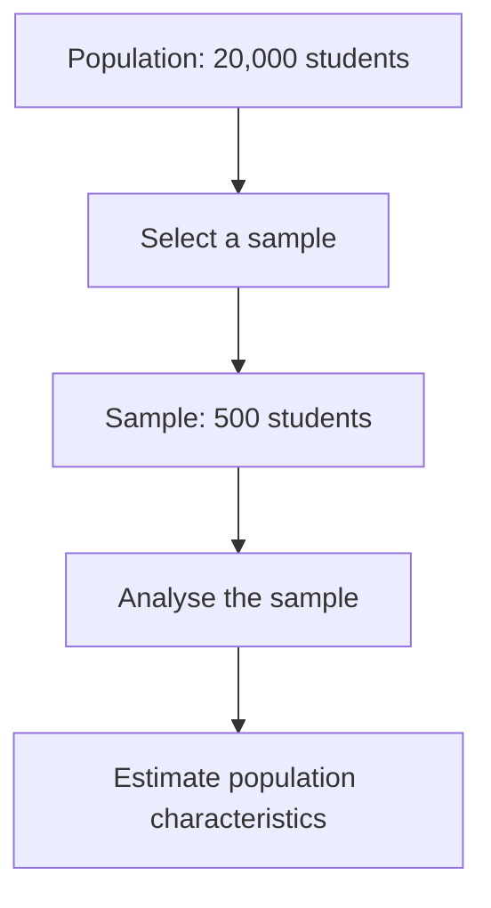

# Statistics Fundamentals

Statistics is the foundation of Data Science, Data Analysis, and Machine Learning. Before applying statistical methods or building predictive models, we need to understand what data represents, how it was collected, how variables are measured, and how conclusions can be drawn from observations.

For example, before predicting customer behaviour, we should understand who the customers are, how the data was collected, whether the dataset represents the target population, and whether errors or biases may affect the results.

This chapter introduces the fundamental concepts needed to work with real-world datasets. It focuses on statistical thinking, data classification, sampling, data collection, data quality, and the basic language of statistics.

---

## 1. Introduction to Statistics

Statistics is the science of **collecting, organising, summarising, analysing, interpreting, and communicating data**.

Data in its raw form may not provide an immediate understanding of a problem. Statistics helps us identify patterns, understand uncertainty, evaluate evidence, and make informed decisions.

In Data Science, statistics helps answer questions such as:

- What does a dataset represent?
- Is the sample representative of the population?
- Which statistical methods are appropriate for a particular variable?
- Could errors or bias affect the results?
- How much uncertainty is present in a conclusion?
- Can information from a sample help us understand a larger population?

Statistics is broadly divided into two major branches.

### 1.1 Descriptive Statistics

Descriptive statistics summarises the observations available in a dataset.

Examples include mean, median, mode, variance, standard deviation, frequency distributions, and graphical summaries.

The detailed calculations and Python implementations are covered in `02_Descriptive_Statistics`.

### 1.2 Inferential Statistics

Inferential statistics uses sample data to estimate population characteristics or evaluate claims about a population.

For example, a university with 20,000 students may survey 500 selected students to estimate the average daily study time of all its students.

The estimate is based on the sample and involves uncertainty. Confidence intervals, hypothesis testing, and related methods are covered in the Inferential Statistics and Hypothesis Testing chapters.

**Key distinction:** Descriptive statistics summarises observed data, while inferential statistics uses data to draw conclusions about a broader population.

---

## 2. Data, Observations, and Variables

### 2.1 What Is Data?

Data is a collection of recorded facts, measurements, values, or observations gathered for a particular purpose.

Consider this student dataset:

| Student | Age | Study Hours | Department |
|---|---:|---:|---|
| A | 20 | 3.5 | CSE |
| B | 21 | 5.0 | CSE |
| C | 20 | 2.0 | ECE |
| D | 22 | 4.5 | CSE |

This dataset contains information about students, including their ages, study hours, and departments.

### 2.2 Observation

An **observation** is one recorded instance in a dataset.

In a typical tabular dataset:

- Each row represents an observation.
- Each column represents a variable or feature.

For example, a dataset containing 1,000 students will generally have 1,000 observations if each student is represented by one row.

### 2.3 Variable

A **variable** is a characteristic that can take different values across observations.

Examples include age, salary, height, product category, study hours, and customer status.

In Machine Learning, variables used as model inputs are commonly called **features**. The variable that a model is trained to predict is commonly called the **target** or **label**.

The meanings of these terms depend on the problem being solved.

---

## 3. Population and Sample

One of the most important concepts in statistics is the distinction between a population and a sample.

### 3.1 Population

A **population** is the complete group of individuals, objects, events, or measurements relevant to a statistical investigation.

Examples include:

- All students enrolled at a university.
- All customers of a company.
- All transactions recorded by a bank during a year.
- All houses in a city.
- All products manufactured during a specified period.

The population does not necessarily consist of people. It is the complete group about which we want to learn.

### 3.2 Sample

A **sample** is a subset of the population selected for analysis.

Suppose a university has 20,000 students and collects information from 500 selected students.

- **Population:** 20,000 students
- **Sample:** 500 selected students

The relationship can be represented as:

$$
\text{Sample} \subseteq \text{Population}
$$



### 3.3 Why Do We Use Samples?

Studying an entire population may be expensive, time-consuming, or impractical. Sampling allows researchers and Data Scientists to analyse a manageable portion of the population.

However, a large sample is not automatically representative. If the sampling method systematically excludes important groups, the resulting conclusions may still be misleading.

### 3.4 Census

A **census** collects information from every member of the population being studied. A sample survey collects information from only a selected subset.

| Census | Sample Survey |
|---|---|
| Attempts to cover the entire population | Studies a subset of the population |
| Often requires more resources | Often requires fewer resources |
| Avoids sampling error when coverage is complete, but other errors can remain | Has sampling error as well as possible non-sampling errors |

A census can still contain missing data, measurement errors, and other problems. Collecting information from everyone does not automatically guarantee perfect data quality.

---

## 4. Parameter and Statistic

A **parameter** is a numerical value describing a population.

A **statistic** is a numerical value calculated from a sample.

Suppose we want to know the average height of every student at a university.

- The average height of all university students is a population parameter.
- The average height of selected students is a sample statistic.

Common notation includes:

| Quantity | Population | Sample |
|---|---|---|
| Mean | $\mu$ | $\bar{x}$ |
| Standard deviation | $\sigma$ | $s$ |
| Variance | $\sigma^2$ | $s^2$ |
| Size | $N$ | $n$ |
| Proportion | $P$ or $\pi$, depending on notation | $\hat{p}$ |

The sample mean is:

$$
\bar{x} = \frac{\sum_{i=1}^{n} x_i}{n}
$$

The population mean is:

$$
\mu = \frac{\sum_{i=1}^{N} x_i}{N}
$$

Here, $x_i$ represents an observation, $n$ is the sample size, and $N$ is the population size.

Sample statistics are often used to estimate unknown population parameters. The difference between a sample statistic and its corresponding population parameter is important when studying statistical uncertainty.

---

## 5. Types of Data

Understanding the type of data is essential because different statistical methods are appropriate for different variables.

Data can first be divided into qualitative and quantitative data.

### 5.1 Qualitative Data

Qualitative data represents categories, labels, or qualities rather than numerical measurements.

Examples include:

- Department
- Blood group
- Product category
- Payment method
- Browser type
- Customer status

For example:

| Customer | Payment Method |
|---|---|
| A | UPI |
| B | Card |
| C | Cash |
| D | UPI |

These values represent categories.

Categories may be encoded numerically, such as `1 = Cash`, `2 = UPI`, and `3 = Card`. However, these codes are labels and do not automatically represent measurable quantities.

### 5.2 Quantitative Data

Quantitative data represents numerical quantities that can be counted or measured.

Examples include:

- Age
- Height
- Weight
- Salary
- Number of purchases
- Website loading time

Quantitative data is commonly divided into discrete and continuous data.

---

## 6. Discrete and Continuous Data

### 6.1 Discrete Data

Discrete data consists of distinct, countable values.

Examples include:

- Number of students in a classroom
- Number of products sold
- Number of defects in a manufactured item
- Number of calls received by a support centre

A count might take values such as:

$$
0, 1, 2, 3, 4, \ldots
$$

A count of complete products sold is normally a whole number rather than a fraction of a product.

### 6.2 Continuous Data

Continuous data represents measurements that can take values throughout a range, subject to the precision of the measurement process.

Examples include:

- Height
- Weight
- Temperature
- Time duration
- Distance

For example, a measured height could be recorded as 170 cm, 170.2 cm, or 170.25 cm.

The number of decimal places recorded depends on the measuring instrument and the required precision.

### Comparison

| Property | Discrete Data | Continuous Data |
|---|---|---|
| Nature | Countable values | Measured values |
| Typical examples | Number of purchases, number of errors | Height, weight, time |
| Possible values | Usually separate count values | Values throughout a range |
| Common source | Counting | Measurement |

Some variables require careful classification. Age, for example, can be recorded as completed years, making the recorded values discrete, even though elapsed time since birth is continuous.

---

## 7. Levels of Measurement

The **level of measurement** describes the mathematical properties of a variable and helps determine which comparisons and operations are meaningful.

The four commonly used levels are nominal, ordinal, interval, and ratio.


### 7.1 Nominal Scale

Nominal data represents categories without a natural ranking.

Examples include:

- Blood group
- City
- Department
- Browser type
- Product category

For example, blood groups A, B, AB, and O are distinct categories. There is no meaningful numerical ordering among them.

Nominal variables are often summarised using frequencies, proportions, and the mode.

### 7.2 Ordinal Scale

Ordinal data contains categories with a meaningful order or ranking, but the differences between categories are not necessarily equal.

Examples include:

- Satisfaction level
- Education level
- Risk category
- Competition position

For example:

$$
\text{Poor} < \text{Average} < \text{Good} < \text{Excellent}
$$

The order is meaningful, but the difference between Poor and Average cannot automatically be assumed to equal the difference between Good and Excellent.

### 7.3 Interval Scale

Interval data has ordered values and meaningful, equal differences, but no true zero representing the complete absence of the measured quantity.

Temperature measured in degrees Celsius is a common example.

The difference between 10°C and 20°C is the same size as the difference between 20°C and 30°C.

However, 20°C is not twice as hot as 10°C because Celsius has an arbitrary zero point.

### 7.4 Ratio Scale

Ratio data has:

- Meaningful order
- Equal intervals
- A meaningful zero

Examples include weight, height, distance, elapsed time, and income when measured as an amount with a meaningful zero.

For example, 20 kg is twice 10 kg because zero kilograms represents the absence of mass.

### Summary

| Scale | Natural Order | Equal Differences | Meaningful True Zero |
|---|---|---|---|
| Nominal | No | No | Not applicable |
| Ordinal | Yes | Not necessarily | Not applicable |
| Interval | Yes | Yes | No |
| Ratio | Yes | Yes | Yes |

The level of measurement helps guide statistical analysis. Calculating the arithmetic mean of arbitrary category codes is generally meaningless, whereas calculating the mean of a suitable numerical measurement can be useful.

---

## 8. Independent and Dependent Variables

A variable can also be described according to its role in a study or prediction task.

### 8.1 Independent Variable

An **independent variable** is a variable that is changed, controlled, or used as a predictor in a particular analysis.

### 8.2 Dependent Variable

A **dependent variable** is the outcome or response being measured or predicted.

Suppose we investigate whether study time is associated with examination scores.

- **Study hours:** Predictor or independent variable
- **Examination score:** Outcome or dependent variable

In Machine Learning, predictor variables are commonly called **features**, while the variable being predicted is called the **target**.

However, using one variable to predict another does not prove that the predictor causes the outcome. Causal conclusions depend on the research design and supporting evidence.

---

## 9. Types of Data Based on Structure

Data can also be classified according to how it is stored and organised.

### 9.1 Structured Data

Structured data follows a defined format, commonly rows and columns.

| ID | Age | Salary |
|---|---:|---:|
| 101 | 24 | 35,000 |
| 102 | 26 | 42,000 |
| 103 | 23 | 30,000 |

Examples include relational database tables, spreadsheets, and many CSV datasets.

### 9.2 Semi-Structured Data

Semi-structured data does not follow a strict relational table format but contains organisational information such as keys, tags, or metadata.

Examples include JSON, XML, and HTML.

Example JSON:

```json
{
  "name": "Aman",
  "age": 22,
  "city": "Lucknow"
}
```

In this example, the keys `name`, `age`, and `city` provide structure, but the data is not stored as a traditional relational table.

### 9.3 Unstructured Data

Unstructured data does not follow a predefined tabular structure.

Examples include:

- Images
- Audio
- Video
- Free-form text
- Documents

Different structures may require different storage, processing, and analytical techniques. For example, a CSV file can often be analysed using pandas, whereas image datasets may require image-processing libraries.

---

## 10. Primary and Secondary Data

### 10.1 Primary Data

Primary data is collected directly by a researcher or organisation for a particular study.

Examples include conducting surveys, interviewing customers, running experiments, and recording measurements.

### 10.2 Secondary Data

Secondary data has already been collected by another person, organisation, or system and is reused for a different analysis.

Examples include government datasets, published research datasets, company reports, historical records, and existing databases.

### Comparison

| Primary Data | Secondary Data |
|---|---|
| Collected directly for the study | Previously collected data |
| Collection can be designed for the current purpose | Original collection may have served another purpose |
| Greater control over the collection process | Less control over the original collection |
| Can require more time and resources | Can be faster and less expensive to obtain |

Before using secondary data, examine its source, definitions, collection method, time period, missing values, and limitations. A dataset that was suitable for its original purpose may not be suitable for a new research question.

---

## 11. Methods of Data Collection

The way data is collected affects its reliability and the conclusions that can be drawn from it.

### 11.1 Surveys

Surveys collect information by asking respondents questions.

Examples include customer satisfaction surveys, student feedback forms, and market research questionnaires.

Good surveys use clear questions, appropriate response options, and a sampling method suited to the target population.

### 11.2 Interviews

Interviews involve asking participants questions directly. They can provide detailed information but may require more time and resources.

### 11.3 Observation

An observational method records behaviour or measurements without assigning a treatment or intervention.

For example, a company may observe customer movement inside a store.

### 11.4 Experiments

An experiment deliberately changes one or more conditions and measures the resulting outcome.

A properly designed experiment can help investigate cause-and-effect relationships, particularly when treatment assignment and other important factors are controlled appropriately.

### 11.5 Existing Records and Databases

Data may also be collected automatically from:

- Transaction databases
- Application logs
- Sensors
- Websites
- Enterprise software

The collection method should always be considered when evaluating the quality, meaning, and limitations of a dataset.

---

## 12. Sampling Methods

**Sampling** is the process of selecting a subset of observations from a population.

The sampling method should be chosen according to the research question, population structure, available resources, and required level of representativeness.


### 12.1 Simple Random Sampling

In simple random sampling, individuals are selected randomly so that each population member has an equal chance of selection under the sampling design.

Suppose a university has 10,000 students and we randomly select 500 students.

The selected students form the sample.

Random selection can reduce certain forms of selection bias when implemented correctly and when the sampling frame adequately covers the target population.

### 12.2 Systematic Sampling

Systematic sampling selects observations at regular intervals after an appropriate starting point.

The sampling interval is commonly calculated as:

$$
k = \frac{N}{n}
$$

where:

- $N$ = population size
- $n$ = required sample size
- $k$ = sampling interval

Suppose the population contains 10,000 customers and the required sample size is 1,000.

$$
k = \frac{10000}{1000} = 10
$$

After selecting a suitable starting point, every 10th customer can be selected.

Systematic sampling is easy to implement, but it can be problematic when the ordering of the population contains periodic patterns that align with the sampling interval.

### 12.3 Stratified Sampling

In stratified sampling, the population is divided into meaningful groups called **strata**, and a sample is selected from each group.

Suppose a university consists of:

- 60% CSE students
- 25% ECE students
- 15% Mechanical Engineering students

A proportional stratified sample of 1,000 students would contain:

$$
n_{\text{CSE}} = 1000 \times 0.60 = 600
$$

$$
n_{\text{ECE}} = 1000 \times 0.25 = 250
$$

$$
n_{\text{Mechanical}} = 1000 \times 0.15 = 150
$$

Therefore:

$$
600 + 250 + 150 = 1000
$$

Stratified sampling is useful when important subgroups need appropriate representation.

### 12.4 Cluster Sampling

In cluster sampling, the population is divided into groups or clusters, and selected clusters are sampled.

For example, a researcher studying students across a city may randomly select several colleges and collect data from students in the selected colleges.

Cluster sampling can reduce collection costs, particularly when population members are geographically or organisationally grouped. However, students within the same college may be more similar to one another than students from different colleges.

### 12.5 Convenience Sampling

Convenience sampling selects observations that are easy to access.

Examples include surveying friends, collecting responses from people at one easily accessible location, or using volunteers who respond to an online post.

It is fast and inexpensive, but it can introduce substantial selection bias because the sample may not represent the target population.

### Comparison of Sampling Methods

| Method | Basic Idea | Main Advantage | Main Limitation |
|---|---|---|---|
| Simple random | Randomly select individuals | Straightforward selection | Requires a suitable sampling frame |
| Systematic | Select every $k$th observation | Easy to implement | Periodic patterns can cause problems |
| Stratified | Sample from important subgroups | Supports subgroup representation | Requires information about strata |
| Cluster | Select groups or clusters | Can reduce collection cost | Selected clusters may not represent all groups |
| Convenience | Select easily available observations | Fast and inexpensive | High risk of selection bias |

---

## 13. Sampling Bias

**Sampling bias** occurs when the sampling process systematically produces a sample that does not adequately represent the target population.

Suppose a university conducts a student satisfaction survey only among students who visit a particular student club. Students who never visit the club have no opportunity to participate.

If club members have different experiences from other students, the results may not represent the entire university.

Common sources of sampling bias include:

- Convenience sampling
- Undercoverage of important population groups
- Voluntary response
- Non-response
- An incomplete or unsuitable sampling frame

Sampling bias is important because increasing the sample size does not necessarily eliminate systematic bias. A very large biased sample can still produce biased estimates.

---

## 14. Sampling Error

Even when sampling is conducted appropriately, a sample may not exactly match the population. This difference is called **sampling error**.

Suppose the population mean is:

$$
\mu = 50
$$

A sample produces:

$$
\bar{x} = 48
$$

The difference between the sample mean and population mean is:

$$
\bar{x} - \mu = 48 - 50 = -2
$$

The sample mean is two units below the population mean.

Sampling error is a consequence of studying a sample rather than the entire population. It is not necessarily evidence that a mistake has been made.

### Sampling Error vs Sampling Bias

| Sampling Error | Sampling Bias |
|---|---|
| Arises from variation between samples | Arises from systematic problems in selection |
| Can occur with proper random sampling | Results from a biased sampling process |
| Usually decreases with larger samples under suitable conditions | Does not necessarily disappear as sample size increases |

These concepts should not be confused. Increasing sample size can reduce random sampling variability, but it does not automatically correct a systematically unrepresentative sample.

---

## 15. Non-Sampling Errors

Errors can occur during data collection, recording, processing, and reporting, even when a census is conducted.

These are known as **non-sampling errors**.

### 15.1 Measurement Error

A measured value differs from the actual value because of an inaccurate instrument or measurement procedure.

### 15.2 Response Error

A participant provides an incorrect or misleading answer.

### 15.3 Non-Response Error

Selected participants do not respond, and their characteristics differ systematically from those who respond.

### 15.4 Data Entry Error

A value is incorrectly entered into a database.

For example:

- Correct age: 21
- Entered age: 211

### 15.5 Processing Error

An error occurs during data transformation, aggregation, or computation.

These errors can affect descriptive statistics, statistical inference, and machine learning results. Data validation and quality checks are therefore important parts of a reliable data workflow.

---

## 16. Observational Study vs Experiment

An **observational study** examines variables without assigning a treatment or intervention.

An **experiment** deliberately assigns a treatment or changes a condition and measures the outcome.

Suppose we want to investigate whether a new teaching method improves examination performance.

**Observational approach:** We observe students who naturally use different study methods and compare their examination scores.

**Experimental approach:** We assign students to groups and provide one group with the new teaching method, following an appropriate study design.

### Comparison

| Observational Study | Experiment |
|---|---|
| Observes existing conditions | Assigns or controls conditions |
| No researcher-assigned treatment | Researcher assigns an intervention |
| Often easier to conduct | Often provides greater control |
| Confounding can complicate causal conclusions | Can support causal conclusions when properly designed |

An association between two variables does not automatically prove causation. Other variables, reverse causality, or coincidence may explain an observed relationship.

---

## 17. Statistical Notation

Statistical notation provides a compact way to represent observations and calculations.

Suppose a dataset contains:

$$
x_1, x_2, x_3, \ldots, x_n
$$

Here, $x_i$ represents the $i$th observation and $n$ is the number of observations.

### 17.1 Summation Notation

The symbol $\sum$ represents addition.

For example:

$$
\sum_{i=1}^{n} x_i
$$

means:

$$
x_1 + x_2 + x_3 + \cdots + x_n
$$

If the observations are 10, 20, and 30:

$$
\sum_{i=1}^{3} x_i = 10 + 20 + 30 = 60
$$

### 17.2 Sample and Population Notation

The sample mean is:

$$
\bar{x} = \frac{\sum_{i=1}^{n} x_i}{n}
$$

The population mean is:

$$
\mu = \frac{\sum_{i=1}^{N} x_i}{N}
$$

The symbols remind us whether a calculation describes a sample or an entire population.

Detailed descriptive measures and their calculations are covered in `02_Descriptive_Statistics`. This section introduces the notation needed to understand the formulas in later chapters.

---

## 18. Basic Statistical Calculations

This section introduces a few basic calculations to demonstrate how notation is applied. Detailed explanations and additional worked examples belong in `02_Descriptive_Statistics`.

### 18.1 Arithmetic Mean

The sample arithmetic mean is:

$$
\bar{x} = \frac{\sum_{i=1}^{n} x_i}{n}
$$

For the observations 10, 20, 30, 40, and 50:

$$
\sum x_i = 10 + 20 + 30 + 40 + 50 = 150
$$

There are five observations:

$$
n = 5
$$

Therefore:

$$
\bar{x} = \frac{150}{5} = 30
$$

The sample mean is 30.

### 18.2 Weighted Mean

A weighted mean is used when observations contribute unequally to a result.

$$
\bar{x}_w = \frac{\sum_{i=1}^{n} w_i x_i}{\sum_{i=1}^{n} w_i}
$$

Here, $x_i$ is an observation and $w_i$ is its weight.

For example, suppose three assessments have the following scores and weights:

| Assessment | Score | Weight |
|---|---:|---:|
| Assignment | 80 | 2 |
| Midterm | 70 | 3 |
| Final | 90 | 5 |

The weighted total is:

$$
80(2) + 70(3) + 90(5) = 820
$$

The total weight is:

$$
2 + 3 + 5 = 10
$$

Therefore:

$$
\bar{x}_w = \frac{820}{10} = 82
$$

The weighted mean is 82.

### 18.3 Proportion and Percentage

A proportion represents the fraction of a whole.

$$
p = \frac{\text{Part}}{\text{Whole}}
$$

A percentage expresses the proportion as a value out of 100.

$$
P = \frac{\text{Part}}{\text{Whole}} \times 100
$$

Suppose 72 out of 90 students pass an examination.

$$
p = \frac{72}{90} = 0.8
$$

The corresponding percentage is:

$$
P = 0.8 \times 100 = 80\%
$$

Relative frequency is one application of proportion and percentage. Its detailed treatment belongs in the Descriptive Statistics chapter.

---

## 19. Data Quality and Statistical Thinking

Statistical analysis is only as reliable as the data and reasoning behind it.

Before analysing a dataset, consider the following questions.

### Is the data relevant?

Does the dataset actually measure the question being investigated?

### Is the data accurate?

Are the recorded values correct, and are the measurement methods reliable?

### Is the data complete?

Are important observations or variables missing?

### Is the sample representative?

Does the sample reasonably represent the target population?

### How was the data collected?

Could the collection process introduce bias, measurement errors, or non-response problems?

### Are the variables clearly defined?

For example, income could mean monthly income, annual income, individual income, or household income.

### Are the units consistent?

Consider the following height measurements:

- 170 cm
- 1.75 m

These values use different units. They must be converted to a consistent unit before comparing or combining them.

Statistical thinking means looking beyond a calculated number and asking where it came from, what it represents, and what limitations apply to it.

---

## 20. Practical Example: Statistics in a Data Science Problem

Consider a university with 10,000 students. The university wants to estimate the average number of hours students spend studying each day.

Collecting data from every student may require substantial time and resources, so the university selects a sample of 500 students.

### Step 1: Identify the Population

The population contains all 10,000 students.

$$
N = 10000
$$

### Step 2: Identify the Sample

The selected sample contains 500 students.

$$
n = 500
$$

### Step 3: Identify the Variable

The variable is daily study time, measured in hours.

It is quantitative and is generally treated as continuous.

### Step 4: Calculate the Sample Mean

Suppose the sum of study hours recorded across the 500 students is 1,750.

$$
\sum_{i=1}^{500} x_i = 1750
$$

The sample mean is:

$$
\bar{x} = \frac{\sum_{i=1}^{n} x_i}{n}
$$

Substituting the values:

$$
\bar{x} = \frac{1750}{500} = 3.5
$$

The average study time in the sample is 3.5 hours per day.

### Step 5: Interpret the Result

The value 3.5 hours describes the sample directly. If the sample was selected appropriately and represents the population reasonably well, it may provide a useful estimate of the population's average study time.

However, the sample mean is not automatically equal to the true population mean.

This example demonstrates how population, sample, variable type, and statistical notation are connected in a real analysis.

---

## 21. Common Mistakes

### Mistake 1: Confusing Population and Sample

A sample is only a subset of the population. Results calculated from a sample should not automatically be treated as exact population values.

### Mistake 2: Treating Category Codes as Numerical Measurements

Suppose:

- 1 = CSE
- 2 = ECE
- 3 = Mechanical Engineering

These numbers are category labels. Their arithmetic mean does not generally have a meaningful interpretation.

### Mistake 3: Assuming a Large Sample Is Always Representative

Sample size alone does not guarantee representativeness. The selection method and coverage of the population are also important.

### Mistake 4: Confusing Sampling Error with Sampling Bias

Sampling error is random variation caused by selecting a sample. Sampling bias is systematic distortion caused by the selection process.

### Mistake 5: Assuming Association Proves Causation

Two variables may be associated because of confounding variables, reverse causality, or other factors.

### Mistake 6: Ignoring Measurement Units

A calculation may be numerically correct but practically misleading if units are inconsistent.

### Mistake 7: Ignoring Missing or Incorrect Data

Incomplete, inaccurate, or poorly collected data can lead to misleading conclusions.

---

## 22. Points to Remember

1. Statistics provides methods for collecting, analysing, interpreting, and communicating data.
2. Descriptive statistics summarises observed data.
3. Inferential statistics uses sample information to learn about a population.
4. A population is the complete group of interest.
5. A sample is a selected subset of the population.
6. A parameter describes a population; a statistic describes a sample.
7. Qualitative data represents categories or qualities.
8. Quantitative data represents numerical quantities.
9. Discrete data is countable, while continuous data is measured over a range.
10. Nominal data has categories without a natural order.
11. Ordinal data has ordered categories.
12. Interval data has equal differences but no true zero.
13. Ratio data has equal differences and a meaningful zero.
14. A feature is commonly used as a model input, while a target is the outcome to be predicted.
15. Structured, semi-structured, and unstructured data require different processing approaches.
16. Primary data is collected directly; secondary data was previously collected and is reused.
17. Sampling methods affect the quality of statistical conclusions.
18. A large biased sample can still produce biased results.
19. Sampling error and sampling bias are different concepts.
20. Non-sampling errors can occur during measurement, recording, and processing.
21. Observational studies and experiments differ in how treatments or conditions are assigned.
22. Association between variables does not automatically establish causation.
23. Statistical results must be interpreted in the context of how the data was collected.

---

## 23. Important Formula Summary

### Sampling Interval

$$
k = \frac{N}{n}
$$

Here, $N$ is the population size and $n$ is the required sample size. This is a common interval calculation for systematic sampling when the population size is divisible by the sample size.

### Sample Mean

$$
\bar{x} = \frac{\sum_{i=1}^{n} x_i}{n}
$$

### Population Mean

$$
\mu = \frac{\sum_{i=1}^{N} x_i}{N}
$$

### Weighted Mean

$$
\bar{x}_w = \frac{\sum_{i=1}^{n} w_i x_i}{\sum_{i=1}^{n} w_i}
$$

### Proportion

$$
p = \frac{\text{Part}}{\text{Whole}}
$$

### Percentage

$$
P = \frac{\text{Part}}{\text{Whole}} \times 100
$$

These formulas are included as a basic reference. Detailed descriptive-statistics formulas are covered in the next chapter.

---

## 24. Quick Concept Comparison

| Concept | Meaning |
|---|---|
| Population | Complete group of interest |
| Sample | Selected subset of the population |
| Parameter | Numerical description of a population |
| Statistic | Numerical description of a sample |
| Descriptive Statistics | Summarises observed data |
| Inferential Statistics | Uses data to draw conclusions about a population |
| Qualitative Data | Categorical data |
| Quantitative Data | Numerical data |
| Discrete Data | Countable numerical data |
| Continuous Data | Measurable numerical data |
| Nominal Scale | Categories without a natural order |
| Ordinal Scale | Ordered categories |
| Interval Scale | Equal differences without a true zero |
| Ratio Scale | Equal differences with a meaningful zero |
| Sampling Error | Random variation arising from sampling |
| Sampling Bias | Systematic distortion in sample selection |
| Primary Data | Data collected directly for a study |
| Secondary Data | Previously collected data reused for analysis |
| Observational Study | Study without researcher-assigned treatment |
| Experiment | Study involving an assigned intervention or controlled condition |

---

## 25. References and Further Reading

### GeeksforGeeks

- [Statistics and Probability](https://www.geeksforgeeks.org/maths/statistics/)
- [Types of Data](https://www.geeksforgeeks.org/maths/types-of-data-in-statistics/)
- [Sampling Methods](https://www.geeksforgeeks.org/maths/sampling-methods/)

### OpenStax

- [Introductory Statistics 2e](https://openstax.org/details/books/introductory-statistics-2e)

### NIST

- [NIST/SEMATECH e-Handbook of Statistical Methods](https://www.itl.nist.gov/div898/handbook/)

### Python Data Analysis

- [pandas Documentation](https://pandas.pydata.org/docs/)
- [NumPy Documentation](https://numpy.org/doc/stable/)

The resources above provide additional explanations of introductory statistics, data collection, sampling, and data analysis.

---
