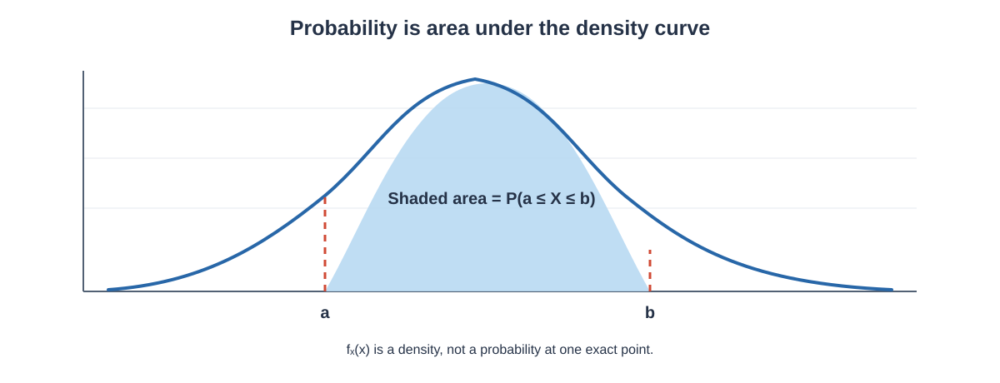

# Probability Distributions

A **probability distribution** describes how probabilities are assigned to the possible values of a random variable.

In the previous chapter, probability was introduced through events, conditional probability, independence, Bayes' theorem, and random variables. A probability distribution takes the next step: it tells us **which values a random variable can take and how probability is distributed across those values**.

Probability distributions are fundamental because they provide mathematical models for uncertain quantities such as the number of purchases, defective products, arrivals, waiting times, measurement errors, examination scores, and sample statistics.

This chapter covers discrete and continuous distributions, probability mass functions, probability density functions, cumulative distribution functions, expected value, variance, and important distributions such as Bernoulli, Binomial, Poisson, Uniform, Normal, Exponential, and related distributions.

## 1. Random Variables and Probability Distributions

A **random variable** is a numerical function that assigns a value to each outcome of a random experiment.

A random variable is commonly represented by \(X\).

For example, suppose a coin is tossed three times and \(X\) represents the number of Heads.

The possible values are:

$X\in\{0,1,2,3\}$

A probability distribution tells us the probability associated with each possible value of \(X\).

| X | P(X = x) |
|---:|---:|
| 0 | 0.125 |
| 1 | 0.375 |
| 2 | 0.375 |
| 3 | 0.125 |

The probabilities must satisfy two conditions:

- Every probability must be non-negative.
- The total probability must equal 1.

The formulas are:

$P(X=x)\geq0$

$\sum_x P(X=x)=1$

A probability distribution therefore provides a complete probabilistic description of a random variable under the chosen model.

## 2. Discrete Probability Distribution

A **discrete random variable** takes countable values.

Examples include the number of customers, defective items, successes, emails received, or Heads in repeated coin tosses.

A discrete probability distribution assigns a probability to each possible value. The probability of a particular value can be positive.

For example, if \(X\) represents the number of defective items in a sample, possible values might be 0, 1, 2, and 3.

### Python Example

```python
import numpy as np

values = np.array([0, 1, 2, 3])
probabilities = np.array([0.1, 0.2, 0.4, 0.3])

print("Possible values:", values)
print("Probabilities:", probabilities)
print("Total probability:", probabilities.sum())
```

The probabilities form a valid distribution because they are non-negative and sum to 1.

## 3. Continuous Probability Distribution

A **continuous random variable** can take values over an interval.

Examples include height, weight, temperature, time, distance, and measurement error.

For a continuous random variable, probability is assigned to intervals rather than individual exact points.

Under the usual continuous probability model:

$P(X=x)=0$

for any single exact value \(x\).

However, the probability that the variable falls within an interval can be positive:

$P(a<X<b)>0$

Continuous distributions are described using a **probability density function (PDF)**.

### Python Example

```python
import numpy as np

measurements = np.array([5.2, 5.7, 6.1, 6.4, 6.8])

print("Mean:", measurements.mean())
print("Standard deviation:", measurements.std())
```

The observations represent measurements that can be modelled using a continuous random variable.

## 4. Discrete vs Continuous Distributions

| Feature | Discrete | Continuous |
|---|---|---|
| Possible values | Countable | Values over intervals |
| Individual value probability | Can be positive | Zero at an exact point |
| Main function | PMF | PDF |
| Probability | Sum of probabilities | Area under density |
| Examples | Binomial, Poisson | Normal, Uniform, Exponential |

The choice between a discrete and continuous model depends on the nature of the random variable and the assumptions of the problem.

## 5. Probability Mass Function

The **probability mass function (PMF)** gives the probability that a discrete random variable equals a particular value.

It is written as:

$p_X(x)=P(X=x)$

A valid PMF must satisfy:

**Non-negativity:** $p_X(x)\geq0$

**Total probability:** $\sum_x p_X(x)=1$

### Worked Example

Suppose a random variable has the following distribution.

| x | P(X = x) |
|---:|---:|
| 0 | 0.2 |
| 1 | 0.5 |
| 2 | 0.3 |

Check the total probability:

$0.2+0.5+0.3=1$

Therefore, the probabilities form a valid PMF.

### Python Example

```python
import numpy as np

probabilities = np.array([0.2, 0.5, 0.3])

print("All probabilities non-negative:",
      np.all(probabilities >= 0))

print("Total probability:", probabilities.sum())
```

## 6. Probability Density Function

A **probability density function (PDF)** describes the density of probability for a continuous random variable. It is commonly written as \(f_X(x)\).

A valid PDF must satisfy:

$f_X(x)\geq0$

and:

$\int_{-\infty}^{\infty}f_X(x)\,dx=1$

The probability that \(X\) lies between \(a\) and \(b\) is:

$P(a\leq X\leq b)=\int_a^b f_X(x)\,dx$

For continuous distributions, probability corresponds to the **area under the density curve**.



**How to read this graph:** The curve is the probability density function \(f_X(x)\). The area between \(a\) and \(b\) represents the probability that the random variable falls in that interval.

The total area under a valid density curve is 1. The probability at any one exact point is 0:

$P(X=a)=0$

Therefore:

$P(a<X<b)=P(a\leq X\leq b)$

for a continuous random variable.

### Python Example

```python
from scipy.stats import norm

# Standard Normal distribution
probability = norm.cdf(1) - norm.cdf(-1)

print("P(-1 <= Z <= 1):", probability)
```

The result is approximately 0.6827, or 68.27%.

## 7. Cumulative Distribution Function

The **cumulative distribution function (CDF)** gives the probability that a random variable is less than or equal to a specified value.

It is written as:

$F_X(x)=P(X\leq x)$

For a discrete random variable:

$F_X(x)=\sum_{t\leq x}P(X=t)$

For a continuous random variable:

$F_X(x)=\int_{-\infty}^{x}f_X(t)\,dt$

A CDF always satisfies:

$0\leq F_X(x)\leq1$

It is also non-decreasing. As \(x\) increases, the cumulative probability cannot decrease.

### Python Example

```python
from scipy.stats import norm

x = 1.0

cdf_value = norm.cdf(x)

print("P(Z <= 1):", cdf_value)
```

For the standard Normal distribution, the result is approximately 0.8413.

## 8. Relationship Between PMF, PDF, and CDF

These three functions describe probability in different ways.

**PMF:** Used for discrete random variables.

$p_X(x)=P(X=x)$

**PDF:** Used for continuous random variables. Probability over an interval is calculated using area.

$P(a<X<b)=\int_a^b f_X(x)\,dx$

**CDF:** Used for both discrete and continuous random variables.

$F_X(x)=P(X\leq x)$

For a continuous distribution, the PDF and CDF are related by:

$f_X(x)=\frac{d}{dx}F_X(x)$

when the derivative exists.

The CDF can be recovered from the PDF using:

$F_X(x)=\int_{-\infty}^{x}f_X(t)\,dt$

## 9. Expected Value of a Discrete Random Variable

The **expected value** represents the theoretical long-run average of a random variable.

For a discrete random variable:

$E(X)=\sum_x xP(X=x)$

### Worked Example

Suppose:

| X | P(X = x) |
|---:|---:|
| 0 | 0.2 |
| 1 | 0.5 |
| 2 | 0.3 |

Calculate the expected value:

$E(X)=0(0.2)+1(0.5)+2(0.3)$

$E(X)=0+0.5+0.6$

Therefore:

$E(X)=1.1$

The expected value does not need to be one of the possible outcomes.

### Python Example

```python
import numpy as np

values = np.array([0, 1, 2])
probabilities = np.array([0.2, 0.5, 0.3])

expected_value = np.sum(values * probabilities)

print("Expected value:", expected_value)
```

## 10. Expected Value of a Continuous Random Variable

For a continuous random variable:

$E(X)=\int_{-\infty}^{\infty}xf_X(x)\,dx$

The function \(xf_X(x)\) weights each possible value by its probability density. The integral combines these weighted values over the entire range.

For example, if \(X\) follows a Uniform distribution between 0 and 10, its expected value is 5.

### Python Example

```python
from scipy.stats import uniform

mean_value = uniform.mean(loc=0, scale=10)

print("Expected value:", mean_value)
```

The `loc` parameter represents the lower endpoint, while `scale` represents the interval width.

## 11. Variance of a Random Variable

**Variance** measures the spread of a random variable around its mean.

The definition is:

$\mathrm{Var}(X)=E[(X-\mu)^2]$

where \(\mu=E(X)\).

An equivalent formula is:

$\mathrm{Var}(X)=E(X^2)-[E(X)]^2$

The standard deviation is:

$SD(X)=\sqrt{\mathrm{Var}(X)}$

A larger variance indicates greater dispersion when comparing variables measured on the same scale.

### Worked Example

Suppose \(X\) takes values 0, 1, and 2 with probabilities 0.2, 0.5, and 0.3.

From Section 9:

$E(X)=1.1$

Calculate the second moment:

$E(X^2)=0^2(0.2)+1^2(0.5)+2^2(0.3)$

$E(X^2)=0+0.5+1.2=1.7$

Now calculate the variance:

$\mathrm{Var}(X)=1.7-(1.1)^2$

$\mathrm{Var}(X)=1.7-1.21$

Therefore:

$\mathrm{Var}(X)=0.49$

The standard deviation is:

$SD(X)=\sqrt{0.49}=0.7$

### Python Example

```python
import numpy as np

values = np.array([0, 1, 2])
probabilities = np.array([0.2, 0.5, 0.3])

mean_value = np.sum(values * probabilities)
second_moment = np.sum((values ** 2) * probabilities)

variance = second_moment - mean_value ** 2
standard_deviation = np.sqrt(variance)

print("Mean:", mean_value)
print("Variance:", variance)
print("Standard deviation:", standard_deviation)
```

## 12. Bernoulli Distribution

The **Bernoulli distribution** models a single trial with exactly two possible outcomes, often called success and failure.

Let:

$X=\begin{cases}1 & \text{success}\\0 & \text{failure}\end{cases}$

Let \(p\) be the probability of success. Then:

$P(X=1)=p$

$P(X=0)=1-p$

The PMF is:

$P(X=x)=p^x(1-p)^{1-x}$

for \(x\in\{0,1\}\).

**Mean:**

$E(X)=p$

**Variance:**

$\mathrm{Var}(X)=p(1-p)$

### Worked Example

Suppose a customer makes a purchase with probability \(p=0.2\).

Then:

$P(X=1)=0.2$

$P(X=0)=0.8$

The expected value is 0.2 and the variance is:

$\mathrm{Var}(X)=0.2(0.8)=0.16$

### Python Example

```python
from scipy.stats import bernoulli

p = 0.2

print("P(X = 1):", bernoulli.pmf(1, p))
print("P(X = 0):", bernoulli.pmf(0, p))
print("Mean:", bernoulli.mean(p))
print("Variance:", bernoulli.var(p))
```

**Application:** Binary classification problems often represent an outcome as 1 for the positive class and 0 for the negative class. A Bernoulli model can describe a single binary outcome.

## 13. Binomial Distribution

The **Binomial distribution** models the number of successes in a fixed number of independent Bernoulli trials when each trial has the same probability of success.

Let:

- \(n\) = number of trials
- \(p\) = probability of success
- \(X\) = number of successes

Then:

$X\sim\mathrm{Binomial}(n,p)$

The probability of exactly \(x\) successes is:

$P(X=x)=\binom{n}{x}p^x(1-p)^{n-x}$

where \(x=0,1,2,\ldots,n\).

### Conditions for a Binomial Model

1. The number of trials is fixed.
2. Each trial has two relevant outcomes.
3. The probability of success is constant.
4. The trials are independent.

### Worked Example

A fair coin is tossed four times. Find the probability of exactly two Heads.

Here, \(n=4\), \(p=0.5\), and \(x=2\).

$P(X=2)=\binom{4}{2}(0.5)^2(0.5)^2$

Since \(\binom{4}{2}=6\):

$P(X=2)=6(0.25)(0.25)$

Therefore:

$P(X=2)=0.375=37.5\%$

**Mean:**

$E(X)=np$

**Variance:**

$\mathrm{Var}(X)=np(1-p)$

For \(n=4\) and \(p=0.5\):

$E(X)=4(0.5)=2$

$\mathrm{Var}(X)=4(0.5)(0.5)=1$

### Python Example

```python
from scipy.stats import binom

n = 4
p = 0.5
x = 2

print("P(X = 2):", binom.pmf(x, n, p))
print("P(X <= 2):", binom.cdf(2, n, p))
print("P(X >= 3):", binom.sf(2, n, p))
print("Mean:", binom.mean(n, p))
print("Variance:", binom.var(n, p))
```

The survival function `sf(2, n, p)` calculates \(P(X>2)\), which is the same as \(P(X\geq3)\) for an integer-valued variable.

**Application:** Binomial models can describe the number of customers who purchase a product out of a fixed number of visitors, provided the assumptions are reasonable.

## 14. Binomial Probability for At Least and At Most

The Binomial formula gives the probability of exactly \(x\) successes.

For example, the probability of at least three successes is:

$P(X\geq3)$

It can be calculated by adding individual probabilities:

$P(X\geq3)=P(X=3)+P(X=4)+\cdots+P(X=n)$

Alternatively, use the complement:

$P(X\geq3)=1-P(X\leq2)$

The complement approach may require fewer calculations.

### Python Example

```python
from scipy.stats import binom

n = 10
p = 0.3

at_least_three = binom.sf(2, n, p)
at_most_three = binom.cdf(3, n, p)

print("P(X >= 3):", at_least_three)
print("P(X <= 3):", at_most_three)
```

## 15. Poisson Distribution

The **Poisson distribution** models the number of events occurring within a fixed interval of time, distance, area, or another exposure unit under appropriate assumptions.

Let:

$X\sim\mathrm{Poisson}(\lambda)$

Here, \(\lambda\) represents the expected number of events in the interval.

The PMF is:

$P(X=x)=\frac{e^{-\lambda}\lambda^x}{x!}$

for \(x=0,1,2,\ldots\).

**Mean:**

$E(X)=\lambda$

**Variance:**

$\mathrm{Var}(X)=\lambda$

Therefore:

$E(X)=\mathrm{Var}(X)=\lambda$

### Worked Example

A support centre receives an average of three calls per minute. Find the probability of exactly two calls in one minute.

Here, \(\lambda=3\) and \(x=2\).

$P(X=2)=\frac{e^{-3}3^2}{2!}$

Since \(3^2=9\) and \(2!=2\):

$P(X=2)=\frac{9e^{-3}}{2}$

Using \(e^{-3}\approx0.0498\):

$P(X=2)\approx0.224$

Therefore, the probability is approximately 22.4%.

### Python Example

```python
from scipy.stats import poisson

lam = 3

print("P(X = 2):", poisson.pmf(2, lam))
print("P(X <= 2):", poisson.cdf(2, lam))
print("P(X >= 2):", poisson.sf(1, lam))
print("Mean:", poisson.mean(lam))
print("Variance:", poisson.var(lam))
```

**Application:** Poisson models can be useful for analysing support tickets, website requests, equipment failures, or arrivals per interval when the model assumptions are reasonable.

## 16. Geometric Distribution

The **Geometric distribution** models the number of independent trials required to obtain the first success when each trial has the same success probability.

Let \(p\) be the success probability and \(X\) be the trial number on which the first success occurs.

Then:

$P(X=x)=(1-p)^{x-1}p$

for \(x=1,2,3,\ldots\).

### Worked Example

Suppose each trial has success probability \(p=0.2\). Find the probability that the first success occurs on the third trial.

$P(X=3)=(1-0.2)^2(0.2)$

$P(X=3)=(0.8)^2(0.2)$

$P(X=3)=0.64(0.2)=0.128$

Therefore, the probability is 12.8%.

For this parameterisation:

$E(X)=\frac{1}{p}$

$\mathrm{Var}(X)=\frac{1-p}{p^2}$

### Python Example

```python
from scipy.stats import geom

p = 0.2

print("P(first success on trial 3):", geom.pmf(3, p))
print("Expected trial count:", geom.mean(p))
print("Variance:", geom.var(p))
```

**Important:** Some textbooks define the Geometric random variable as the number of failures before the first success. That version starts at zero rather than one. Always check the definition.

## 17. Negative Binomial Distribution

The **Negative Binomial distribution** generalises the Geometric distribution by considering the number of trials needed to obtain a specified number of successes.

Let \(X\) be the number of trials required to obtain \(r\) successes. One common form is:

$P(X=x)=\binom{x-1}{r-1}p^r(1-p)^{x-r}$

where \(x=r,r+1,\ldots\).

The Geometric distribution is a special case with \(r=1\).

For this trials-until-\(r\)-successes parameterisation:

$E(X)=\frac{r}{p}$

$\mathrm{Var}(X)=\frac{r(1-p)}{p^2}$

### Python Example

SciPy's `nbinom` uses the number of failures before the specified number of successes. If \(F\) is the number of failures, then the number of trials is \(X=F+r\).

```python
from scipy.stats import nbinom

r = 3
p = 0.4

# Probability of 5 failures before the 3rd success
probability = nbinom.pmf(5, r, p)

print("P(5 failures before 3 successes):", probability)

# Expected number of failures
print("Expected failures:", nbinom.mean(r, p))

# Expected number of trials
print("Expected trials:", r * (1 - p) / p + r)
```

The Negative Binomial distribution can be useful for count data that show more variability than a simple Poisson model allows, depending on the data-generating process.

## 18. Hypergeometric Distribution

The **Hypergeometric distribution** models the number of successes in a sample drawn **without replacement** from a finite population.

Let:

- \(N\) = population size
- \(K\) = number of successes in the population
- \(n\) = sample size
- \(X\) = number of successes selected

The PMF is:

$P(X=x)=\frac{\binom{K}{x}\binom{N-K}{n-x}}{\binom{N}{n}}$

### Worked Example

A box contains 10 products: four defective and six non-defective. Three products are selected without replacement. Find the probability that exactly two are defective.

Here, \(N=10\), \(K=4\), \(n=3\), and \(x=2\).

$P(X=2)=\frac{\binom{4}{2}\binom{6}{1}}{\binom{10}{3}}$

Calculate:

$\binom{4}{2}=6$

$\binom{6}{1}=6$

$\binom{10}{3}=120$

Therefore:

$P(X=2)=\frac{36}{120}=0.3$

The probability is 30%.

### Python Example

```python
from scipy.stats import hypergeom

N = 10
K = 4
n = 3
x = 2

print("P(X = 2):", hypergeom.pmf(x, N, K, n))
print("P(X <= 2):", hypergeom.cdf(2, N, K, n))
print("Expected value:", hypergeom.mean(N, K, n))
print("Variance:", hypergeom.var(N, K, n))
```

**Important:** Sampling without replacement changes the probabilities across selections. This is why a Hypergeometric model may be more appropriate than a Binomial model.

## 19. Uniform Distribution

The **continuous Uniform distribution** assigns equal density across an interval.

If:

$X\sim U(a,b)$

then the PDF is:

$f(x)=\frac{1}{b-a}$ for $a\leq x\leq b$

and \(f(x)=0\) outside the interval.

**Mean:**

$E(X)=\frac{a+b}{2}$

**Variance:**

$\mathrm{Var}(X)=\frac{(b-a)^2}{12}$

### Worked Example

Suppose \(X\sim U(0,10)\). Find the probability that \(X\) lies between 2 and 6.

The probability is the length of the required interval divided by the total interval length:

$P(2\leq X\leq6)=\frac{6-2}{10-0}$

$P(2\leq X\leq6)=\frac{4}{10}=0.4$

The mean is:

$E(X)=\frac{0+10}{2}=5$

### Python Example

```python
from scipy.stats import uniform

a = 0
b = 10

distribution = uniform(loc=a, scale=b - a)

print("P(2 <= X <= 6):",
      distribution.cdf(6) - distribution.cdf(2))

print("Mean:", distribution.mean())
print("Variance:", distribution.var())
```

## 20. Normal Distribution

The **Normal distribution** is one of the most important continuous probability distributions. It is symmetric and bell-shaped.

A Normal random variable is commonly written as:

$X\sim N(\mu,\sigma^2)$

where:

- \(\mu\) = mean
- \(\sigma^2\) = variance
- \(\sigma\) = standard deviation

Its PDF is:

$f(x)=\frac{1}{\sigma\sqrt{2\pi}}e^{-\frac{(x-\mu)^2}{2\sigma^2}}$

for \(-\infty<x<\infty\).

### Important Properties

For a Normal distribution:

$\text{Mean}=\text{Median}=\text{Mode}=\mu$

The distribution is symmetric around \(\mu\).

Approximately:

- 68% of observations lie within one standard deviation of the mean.
- 95% lie within two standard deviations.
- 99.7% lie within three standard deviations.

This is commonly called the **68–95–99.7 rule**.

### Python Example

```python
from scipy.stats import norm

mu = 100
sigma = 15

distribution = norm(loc=mu, scale=sigma)

print("Mean:", distribution.mean())
print("Variance:", distribution.var())
print("P(X <= 115):", distribution.cdf(115))
print("P(85 <= X <= 115):",
      distribution.cdf(115) - distribution.cdf(85))
```

**Application:** Normal models are widely used in statistical analysis, measurement modelling, and methods involving sampling distributions. However, not every dataset follows a Normal distribution.

## 21. Standard Normal Distribution

The **Standard Normal distribution** has:

$\mu=0$

$\sigma=1$

It is commonly represented by:

$Z\sim N(0,1)$

A general Normal variable can be standardised using the **z-score**:

$Z=\frac{X-\mu}{\sigma}$

The z-score tells us how many standard deviations an observation lies above or below the mean.

### Worked Example

Suppose \(X=70\), \(\mu=60\), and \(\sigma=5\).

$Z=\frac{70-60}{5}$

$Z=\frac{10}{5}=2$

Therefore, \(Z=2\). The observation is two standard deviations above the mean.

### Python Example

```python
from scipy.stats import norm

x = 70
mu = 60
sigma = 5

z_score = (x - mu) / sigma
probability = norm.cdf(z_score)

print("Z-score:", z_score)
print("P(Z <= z):", probability)
```

## 22. Empirical Rule

For an approximately Normal distribution:

**Within one standard deviation**

$\mu-\sigma\leq X\leq\mu+\sigma$

contains approximately 68% of observations.

**Within two standard deviations**

$\mu-2\sigma\leq X\leq\mu+2\sigma$

contains approximately 95%.

**Within three standard deviations**

$\mu-3\sigma\leq X\leq\mu+3\sigma$

contains approximately 99.7%.

### Worked Example

Suppose \(\mu=100\) and \(\sigma=10\).

Approximately 95% of observations lie within two standard deviations:

$100-2(10)\leq X\leq100+2(10)$

Therefore:

$80\leq X\leq120$

### Python Example

```python
from scipy.stats import norm

mu = 100
sigma = 10

lower = mu - 2 * sigma
upper = mu + 2 * sigma

probability = (
    norm.cdf(upper, loc=mu, scale=sigma)
    - norm.cdf(lower, loc=mu, scale=sigma)
)

print("Interval:", lower, "to", upper)
print("Probability:", probability)
```

The result is approximately 0.9545, or 95.45%, for the exact Normal model.

## 23. Exponential Distribution

The **Exponential distribution** is commonly used to model waiting time until an event occurs under an appropriate constant-rate process.

Let:

$X\sim\mathrm{Exponential}(\lambda)$

where \(\lambda>0\) is the rate parameter.

Its PDF is:

$f(x)=\lambda e^{-\lambda x}$ for $x\geq0$

and \(f(x)=0\) for \(x<0\).

**Mean:**

$E(X)=\frac{1}{\lambda}$

**Variance:**

$\mathrm{Var}(X)=\frac{1}{\lambda^2}$

**CDF:**

$F(x)=1-e^{-\lambda x}$ for \(x\geq0\).

### Worked Example

Suppose the average waiting time is five minutes.

Then:

$E(X)=5$

Since \(E(X)=1/\lambda\):

$\lambda=\frac{1}{5}=0.2$

Find the probability that the waiting time is less than three minutes.

$P(X\leq3)=1-e^{-0.2(3)}$

$P(X\leq3)=1-e^{-0.6}$

Using \(e^{-0.6}\approx0.5488\):

$P(X\leq3)\approx1-0.5488=0.4512$

The probability is approximately 45.12%.

### Python Example

```python
from scipy.stats import expon

average_wait = 5
rate = 1 / average_wait

# SciPy uses scale = 1 / rate
distribution = expon(scale=1 / rate)

print("Rate:", rate)
print("P(X <= 3):", distribution.cdf(3))
print("Mean:", distribution.mean())
print("Variance:", distribution.var())
```

**Application:** The Exponential distribution can model waiting times between events in suitable constant-rate processes.

## 24. Memoryless Property of the Exponential Distribution

The Exponential distribution has an important property called **memorylessness**.

For \(s,t\geq0\):

$P(X>s+t\mid X>s)=P(X>t)$

This means that, given the process has already lasted for \(s\) units of time, the additional waiting time has the same distribution as a fresh waiting time under the model.

This property distinguishes the Exponential distribution from many other continuous distributions.

### Python Example

```python
from scipy.stats import expon

rate = 0.2
s = 4
t = 3

left_side = expon.sf(s + t, scale=1 / rate) / expon.sf(
    s, scale=1 / rate
)

right_side = expon.sf(t, scale=1 / rate)

print("Conditional survival probability:", left_side)
print("Fresh survival probability:", right_side)
```

The values agree apart from possible numerical rounding, illustrating the memoryless property.

## 25. Geometric and Exponential Distributions

The Geometric and Exponential distributions have a conceptual similarity.

| Distribution | Random Variable |
|---|---|
| Geometric | Number of discrete trials until the first success |
| Exponential | Continuous waiting time until an event |

Both have a memoryless property under their standard definitions.

The key difference is that the Geometric distribution is discrete, whereas the Exponential distribution is continuous.

## 26. Poisson and Exponential Relationship

The Poisson and Exponential distributions are closely related when modelling a Poisson process with a constant event rate.

- **Poisson distribution:** Number of events in an interval.
- **Exponential distribution:** Waiting time between events.

If events occur at rate \(\lambda\), the number of events in time \(t\) can be modelled as:

$N(t)\sim\mathrm{Poisson}(\lambda t)$

The waiting time to the next event can be modelled as:

$X\sim\mathrm{Exponential}(\lambda)$

under the standard Poisson-process assumptions.

### Python Example

```python
from scipy.stats import poisson, expon

rate = 3
time_interval = 2

# Event count over two time units
event_count_probability = poisson.pmf(
    4, rate * time_interval
)

# Waiting time until the next event
waiting_time_probability = expon.cdf(
    1, scale=1 / rate
)

print("P(4 events in 2 time units):",
      event_count_probability)

print("P(waiting time <= 1 time unit):",
      waiting_time_probability)
```

## 27. Normal Distribution and Z-Scores

The z-score transformation converts a Normal random variable into the standard scale:

$Z=\frac{X-\mu}{\sigma}$

Suppose \(X\sim N(50,10^2)\) and the observed value is \(X=70\).

$Z=\frac{70-50}{10}$

Therefore:

$Z=2$

This means the value is two standard deviations above the mean.

A z-score can be positive, negative, or zero:

- Positive: above the mean.
- Negative: below the mean.
- Zero: equal to the mean.

### Python Example

```python
from scipy.stats import norm

mu = 50
sigma = 10
x = 70

z = (x - mu) / sigma

print("Z-score:", z)
print("Lower-tail probability:", norm.cdf(z))
print("Upper-tail probability:", norm.sf(z))
```

## 28. Expected Value and Variance Rules

Probability distributions become easier to manipulate when we know the standard rules for expectation and variance.

For constants \(a\) and \(b\):

$E(aX+b)=aE(X)+b$

For variance:

$\mathrm{Var}(aX+b)=a^2\mathrm{Var}(X)$

Adding a constant changes the location but does not change the variance.

Multiplying a random variable by \(a\) multiplies its standard deviation by \(|a|\) and its variance by \(a^2\).

### Python Example

```python
import numpy as np

data = np.array([10, 12, 14, 16, 18])

a = 3
b = 5
transformed = a * data + b

print("Original mean:", data.mean())
print("Transformed mean:", transformed.mean())

print("Original variance:", data.var())
print("Transformed variance:", transformed.var())
```

NumPy's default variance calculation uses population variance, with `ddof=0`.

## 29. Sum of Independent Random Variables

For any two random variables with finite variances:

$E(X+Y)=E(X)+E(Y)$

The general variance rule is:

$\mathrm{Var}(X+Y)=\mathrm{Var}(X)+\mathrm{Var}(Y)+2\mathrm{Cov}(X,Y)$

For independent random variables, covariance is zero. Therefore:

$\mathrm{Var}(X+Y)=\mathrm{Var}(X)+\mathrm{Var}(Y)$

More generally, for independent random variables:

$\mathrm{Var}\left(\sum_{i=1}^{n}X_i\right)=\sum_{i=1}^{n}\mathrm{Var}(X_i)$

Independence is important for the simple variance addition rule.

### Worked Example

Suppose \(X\) and \(Y\) are independent, with:

$\mathrm{Var}(X)=4$

$\mathrm{Var}(Y)=9$

Then:

$\mathrm{Var}(X+Y)=4+9=13$

The standard deviation of the sum is:

$SD(X+Y)=\sqrt{13}\approx3.606$

### Python Example

```python
import numpy as np

rng = np.random.default_rng(42)

x = rng.normal(loc=10, scale=2, size=100_000)
y = rng.normal(loc=5, scale=3, size=100_000)

total = x + y

print("Variance of X:", np.var(x))
print("Variance of Y:", np.var(y))
print("Variance of X + Y:", np.var(total))
```

The simulated result should be close to \(4+9=13\), subject to sampling variation.

## 30. Law of Total Expectation

The **law of total expectation** states:

$E(X)=E[E(X\mid Y)]$

This means that the overall expected value can be obtained by averaging conditional expected values.

For a discrete \(Y\):

$E(X)=\sum_y E(X\mid Y=y)P(Y=y)$

This is useful when a random variable behaves differently across different groups or conditions.

### Worked Example

Suppose 60% of customers belong to Group A and 40% belong to Group B.

The expected purchase amounts are 100 for Group A and 200 for Group B.

The overall expected purchase amount is:

$E(X)=100(0.6)+200(0.4)$

$E(X)=60+80=140$

### Python Example

```python
import numpy as np

conditional_means = np.array([100, 200])
group_probabilities = np.array([0.6, 0.4])

overall_mean = np.sum(
    conditional_means * group_probabilities
)

print("Overall expected value:", overall_mean)
```

## 31. Central Limit Theorem — Introduction

The **Central Limit Theorem (CLT)** is one of the most important results connecting probability distributions with statistical inference.

Under appropriate conditions, the distribution of the sample mean becomes approximately Normal as the sample size becomes sufficiently large, even when the original population distribution is not Normal.

Suppose independent observations have mean \(\mu\) and variance \(\sigma^2\).

For a sample of size \(n\), the sample mean is:

$\bar{X}=\frac{1}{n}\sum_{i=1}^{n}X_i$

Its mean is:

$E(\bar{X})=\mu$

Its variance is:

$\mathrm{Var}(\bar{X})=\frac{\sigma^2}{n}$

Therefore, its standard deviation, called the **standard error of the sample mean**, is:

$SE(\bar{X})=\frac{\sigma}{\sqrt{n}}$

Under the CLT, the standardised sample mean becomes approximately standard Normal for sufficiently large samples under suitable assumptions:

$Z=\frac{\bar{X}-\mu}{\sigma/\sqrt{n}}$

The quality of the Normal approximation depends on the underlying distribution, sample size, dependence structure, and other conditions.

### Python Example

```python
import numpy as np

rng = np.random.default_rng(42)

population_sample = rng.exponential(
    scale=1.0, size=100_000
)

sample_size = 50
number_of_samples = 5_000

sample_means = np.array([
    rng.choice(population_sample, size=sample_size).mean()
    for _ in range(number_of_samples)
])

print("Mean of sample means:", sample_means.mean())
print("Standard deviation of sample means:",
      sample_means.std())
```

The sample means tend to form a more symmetric distribution than the original highly right-skewed Exponential population, illustrating the CLT.

## 32. Worked CLT Example

Suppose a population has:

$\mu=100$

$\sigma=20$

A random sample of \(n=100\) observations is collected.

The standard error of the sample mean is:

$SE(\bar{X})=\frac{\sigma}{\sqrt{n}}$

Substitute:

$SE(\bar{X})=\frac{20}{\sqrt{100}}$

$SE(\bar{X})=\frac{20}{10}$

Therefore:

$SE(\bar{X})=2$

The sampling distribution of the mean has standard deviation 2 under the stated assumptions.

### Python Example

```python
import numpy as np

population_mean = 100
population_sd = 20
sample_size = 100

standard_error = population_sd / np.sqrt(sample_size)

print("Standard error:", standard_error)
```

The CLT provides an important foundation for confidence intervals, hypothesis testing, and other methods of inferential statistics.

## 33. Choosing a Probability Distribution

A probability distribution should not be selected simply because its name is familiar. The underlying process and assumptions matter.

### Is the random variable discrete or continuous?

A count is often discrete, while a measurement or waiting time is often continuous.

### Is there a fixed number of trials?

If there are two outcomes per trial, constant success probability, and independent trials, the Binomial distribution may be appropriate.

### Are we counting events in an interval?

A Poisson model may be appropriate under its assumptions.

### Are we waiting for the first success?

A Geometric model may be appropriate for discrete trials.

### Are we sampling without replacement from a finite population?

A Hypergeometric model may be appropriate.

### Is the variable approximately symmetric and bell-shaped?

A Normal model may be appropriate.

### Are we modelling a continuous waiting time?

An Exponential model may be appropriate under a constant-rate process.

The assumptions behind the model are more important than simply memorising the formula.

## 34. Distribution Comparison

| Distribution | Type | Main Use | Parameters |
|---|---|---|---|
| Bernoulli | Discrete | One success/failure trial | \(p\) |
| Binomial | Discrete | Number of successes in fixed trials | \(n,p\) |
| Poisson | Discrete | Event count in an interval | \(\lambda\) |
| Geometric | Discrete | Trial count until first success | \(p\) |
| Negative Binomial | Discrete | Trials until specified successes | \(r,p\) |
| Hypergeometric | Discrete | Sampling without replacement | \(N,K,n\) |
| Uniform | Continuous | Equal density over an interval | \(a,b\) |
| Normal | Continuous | Symmetric bell-shaped measurements | \(\mu,\sigma^2\) |
| Exponential | Continuous | Waiting time under constant rate | \(\lambda\) |

## 35. Common Mistakes

### Mistake 1: Confusing PMF and PDF

A PMF gives probabilities for discrete values. A PDF gives density for a continuous variable.

### Mistake 2: Treating PDF Values as Probabilities

For a continuous distribution, \(f(x)\) is a density, not generally the probability that \(X=x\).

The probability is obtained from area:

$P(a<X<b)=\int_a^b f(x)\,dx$

### Mistake 3: Forgetting the Conditions of a Binomial Model

A Binomial model requires a fixed number of trials, two outcomes per trial, constant success probability, and independence.

### Mistake 4: Confusing Poisson Rate and Probability

The parameter \(\lambda\) is an average event rate or expected count for the interval, not itself necessarily a probability.

### Mistake 5: Confusing Variance With Standard Deviation

Variance is measured in squared units. Standard deviation is measured in the original units.

### Mistake 6: Using a Normal Model Automatically

Not every numerical dataset is Normally distributed. The shape and modelling assumptions must be considered.

### Mistake 7: Confusing Geometric and Exponential Distributions

Geometric is discrete; Exponential is continuous.

### Mistake 8: Ignoring Sampling Without Replacement

If the population is finite and sampling is without replacement, the Hypergeometric model may be more appropriate than a Binomial model.

### Mistake 9: Assuming the CLT Means the Original Data Becomes Normal

The CLT concerns the distribution of a suitable sample statistic, especially the sample mean, not necessarily the original observations.

### Mistake 10: Mixing Up Parameterisations in Software

Different textbooks and software libraries may define Geometric and Negative Binomial random variables differently. Check whether the variable counts trials or failures before interpreting the result.

## 36. Points to Remember

1. A probability distribution describes how probability is assigned to a random variable.
2. Discrete random variables have countable possible values.
3. Continuous random variables take values over intervals.
4. A PMF is used for discrete random variables.
5. A PDF is used for continuous random variables.
6. A CDF gives \(P(X\leq x)\).
7. Expected value describes a theoretical long-run average.
8. Variance measures squared spread.
9. Standard deviation is the square root of variance.
10. Bernoulli models one success/failure trial.
11. Binomial models the number of successes in fixed independent trials.
12. Poisson models event counts over an interval under appropriate assumptions.
13. Geometric models trials until the first success.
14. Negative Binomial models trials until a specified number of successes under the chosen parameterisation.
15. Hypergeometric models sampling without replacement.
16. Uniform assigns constant density over an interval.
17. Normal is a symmetric bell-shaped continuous distribution.
18. The z-score measures distance from the mean in standard-deviation units.
19. Exponential models continuous waiting time under a constant-rate process.
20. Poisson and Exponential distributions are closely related through the Poisson process.
21. The CLT concerns the sampling distribution of suitable statistics such as the sample mean.
22. Always check the assumptions before selecting a probability distribution.
23. Use Python libraries such as NumPy and SciPy to calculate probabilities and validate theoretical results.

## 37. Important Formula Summary

### PMF

$p_X(x)=P(X=x)$

### CDF

$F_X(x)=P(X\leq x)$

### Continuous Probability

$P(a\leq X\leq b)=\int_a^b f_X(x)\,dx$

### Expected Value — Discrete

$E(X)=\sum_x xP(X=x)$

### Expected Value — Continuous

$E(X)=\int_{-\infty}^{\infty}xf_X(x)\,dx$

### Variance

$\mathrm{Var}(X)=E[(X-E(X))^2]$

### Alternative Variance Formula

$\mathrm{Var}(X)=E(X^2)-[E(X)]^2$

### Bernoulli

$P(X=x)=p^x(1-p)^{1-x}$

$E(X)=p$

$\mathrm{Var}(X)=p(1-p)$

### Binomial

$P(X=x)=\binom{n}{x}p^x(1-p)^{n-x}$

$E(X)=np$

$\mathrm{Var}(X)=np(1-p)$

### Poisson

$P(X=x)=\frac{e^{-\lambda}\lambda^x}{x!}$

$E(X)=\mathrm{Var}(X)=\lambda$

### Geometric

$P(X=x)=(1-p)^{x-1}p$

$E(X)=\frac{1}{p}$

$\mathrm{Var}(X)=\frac{1-p}{p^2}$

### Negative Binomial

$P(X=x)=\binom{x-1}{r-1}p^r(1-p)^{x-r}$

$E(X)=\frac{r}{p}$

$\mathrm{Var}(X)=\frac{r(1-p)}{p^2}$

### Hypergeometric

$P(X=x)=\frac{\binom{K}{x}\binom{N-K}{n-x}}{\binom{N}{n}}$

### Uniform PDF

$f(x)=\frac{1}{b-a}$ for \(a\leq x\leq b\)

### Uniform Mean

$E(X)=\frac{a+b}{2}$

### Uniform Variance

$\mathrm{Var}(X)=\frac{(b-a)^2}{12}$

### Normal PDF

$f(x)=\frac{1}{\sigma\sqrt{2\pi}}e^{-\frac{(x-\mu)^2}{2\sigma^2}}$

### Z-Score

$Z=\frac{X-\mu}{\sigma}$

### Exponential PDF

$f(x)=\lambda e^{-\lambda x}$ for \(x\geq0\)

### Exponential CDF

$F(x)=1-e^{-\lambda x}$ for \(x\geq0\)

### Exponential Mean

$E(X)=\frac{1}{\lambda}$

### Exponential Variance

$\mathrm{Var}(X)=\frac{1}{\lambda^2}$

### Variance of a Sum

For any two random variables with finite variances:

$\mathrm{Var}(X+Y)=\mathrm{Var}(X)+\mathrm{Var}(Y)+2\mathrm{Cov}(X,Y)$

For independent random variables:

$\mathrm{Var}(X+Y)=\mathrm{Var}(X)+\mathrm{Var}(Y)$

### Sample Mean Standard Error

$SE(\bar{X})=\frac{\sigma}{\sqrt{n}}$

## 38. Quick Concept Comparison

| Concept | Main Question |
|---|---|
| PMF | What is \(P(X=x)\) for a discrete value? |
| PDF | How is continuous probability density distributed? |
| CDF | What is \(P(X\leq x)\)? |
| Expected Value | What is the theoretical average? |
| Variance | How spread out is the random variable? |
| Bernoulli | What happens in one success/failure trial? |
| Binomial | How many successes occur in fixed trials? |
| Poisson | How many events occur in an interval? |
| Geometric | How many trials until the first success? |
| Negative Binomial | How many trials until a specified number of successes? |
| Hypergeometric | How many successes are selected without replacement? |
| Uniform | Is density constant across an interval? |
| Normal | Is the variable modelled by a symmetric bell curve? |
| Exponential | How long until an event occurs? |
| Z-score | How many standard deviations from the mean? |
| CLT | What happens to the sampling distribution of the mean as sample size grows? |

## 39. Chapter Summary

Probability distributions provide mathematical models for random variables.

The first distinction is between **discrete and continuous random variables**. Discrete variables use probability mass functions, while continuous variables use probability density functions. The cumulative distribution function provides a common framework for describing the probability that a random variable is less than or equal to a given value.

The **Bernoulli and Binomial distributions** describe success/failure processes. The **Poisson distribution** describes event counts, while the **Geometric and Negative Binomial distributions** describe trial counts until specified successes. The **Hypergeometric distribution** is appropriate for sampling without replacement.

For continuous variables, the **Uniform distribution** represents constant density over an interval, the **Normal distribution** provides the familiar bell-shaped model, and the **Exponential distribution** models waiting time under a constant-rate process.

Expected value and variance provide numerical summaries of probability distributions, while standardisation through the z-score provides a common scale for Normal variables.

The **Central Limit Theorem** explains why the sampling distribution of the mean becomes approximately Normal under suitable conditions as the sample size increases. This result provides an important foundation for inferential statistics.

Python makes these concepts practical. NumPy supports numerical calculations and simulation, while SciPy provides distribution functions for evaluating probabilities, cumulative probabilities, means, and variances.

The most important habit is not to memorise distributions mechanically. Instead, identify the random variable, understand the data-generating process, check the assumptions, and then select an appropriate probability model.

## 40. References

### GeeksforGeeks

- [Probability and Statistics](https://www.geeksforgeeks.org/maths/statistics/)
- [Probability](https://www.geeksforgeeks.org/maths/probability/)

### OpenStax

- [Introductory Statistics 2e](https://openstax.org/details/books/introductory-statistics-2e)

### SciPy Documentation

- [SciPy Statistics Module](https://docs.scipy.org/doc/scipy/reference/stats.html)
- [Continuous and Discrete Distributions](https://docs.scipy.org/doc/scipy/reference/stats.html)

### NumPy Documentation

- [NumPy Documentation](https://numpy.org/doc/stable/)
- [NumPy Random Sampling](https://numpy.org/doc/stable/reference/random/index.html)

### Further Reading

These resources provide additional explanations of probability distributions, their mathematical properties, and their implementation in Python. Use them alongside the worked examples and notebooks in this repository.
